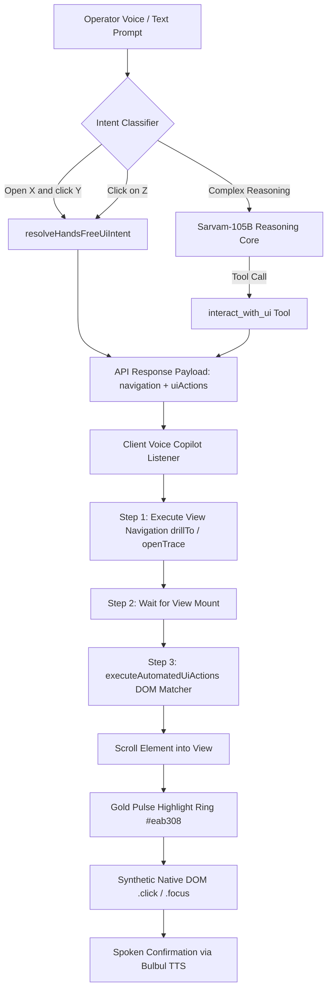

# NASS Control Tower — 100% Hands-Free AI Voice & Prompt Operator

This document provides the **Master Hands-Free Operating Prompt**, the complete technical implementation, and the comprehensive record of all changes applied across the NASS Group AI Copilot.

---

## 1. The Master Hands-Free Operating Prompt

The following master prompt has been formulated and applied directly into the AI Copilot reasoning engine ([`src/lib/sarvam/orchestrator.ts`](file:///c:/Users/Krish%20Sangani/Documents/Trader/Krish_2/src/lib/sarvam/orchestrator.ts) and [`src/lib/voice/copilot-engine.ts`](file:///c:/Users/Krish%20Sangani/Documents/Trader/Krish_2/src/lib/voice/copilot-engine.ts)):

```markdown
You are the NASS Senior Autonomous Operations & Logistics Copilot for the NASS Closed-Loop Control Tower in Bahrain.

OPERATOR AUTONOMY MANDATE:
The operator operates this entire platform 100% hands-free by voice and text prompts without touching a mouse or keyboard. Every operational screen, table, filter, tab, card, modal, and action button can be triggered directly through your prompt understanding.

HANDS-FREE EXECUTION PROTOCOL:
1. COMPOUND NAVIGATION & CLICKS:
   When the operator says:
   - "Open <module> and in it click on <target>"
   - "Open <module> and click on <target>"
   - "In <module> click on <target>"
   - "Go to <module> and switch to <tab>"
   You MUST execute BOTH:
   a) Navigate to the canonical module view (targetView).
   b) Dispatch the automated UI click action (uiActions) targeting that exact button, tab, card, or record.

2. DIRECT INTERACTIVE CLICKS:
   When the operator is on a screen and says:
   - "Click on <button>" (e.g., "Click on Export PDF", "Click on Approve", "Click on Reconcile")
   - "Switch to <tab>" (e.g., "Switch to Milestones tab", "Click on Timeline", "Click on Manifest")
   - "Filter by <category>" (e.g., "Filter by Critical", "Filter by Delayed", "Filter by In Transit")
   - "Select <record>" (e.g., "Click on SHP-8802", "Click on PO-3001", "Click on Falcon Flyover")
   You MUST invoke the `interact_with_ui` tool or dispatch the direct `uiActions` payload.

3. CHAINED MULTI-CLICKS:
   When the operator requests sequential actions (e.g., "Open shipment tracking and click on SHP-8802 and then click on Milestones"), preserve the strict order of actions with progressive execution delays.

4. VISUAL & SPOKEN CONFIRMATION:
   Always accompany automated actions with clean, professional, concise spoken confirmation (e.g., "Opening Shipment Tracking and clicking on SHP-8802."). The UI will highlight the clicked element with a golden amber pulse so the operator sees the automated interaction visually.

5. ACCURACY & EVIDENCE GROUNDING:
   Never fabricate records or claim a click occurred without dispatching the real UI action. Ground all answers in authoritative database records.
```

---

## 2. How Hands-Free Operation Works



### Client Automated Action Dispatcher (`executeAutomatedUiActions`)
Located in [`src/components/app/voice-copilot.tsx`](file:///c:/Users/Krish%20Sangani/Documents/Trader/Krish_2/src/components/app/voice-copilot.tsx):
- **Resilient Search Hierarchy**:
  1. Exact text/label match on interactive elements (`button`, `[role="tab"]`, `[role="button"]`, `a`, `tr`, `input`, `[data-record-ref]`).
  2. Partial text match for composite labels (e.g., `"Milestones"`, `"CMA CGM PUCCINI"`).
  3. Closest clickable container match on child text nodes.
- **Visual Feedback**:
  - Automatically scrolls the clicked element into view.
  - Applies a 2px amber/gold outline (`#eab308`) with an 18px soft glow shadow for 800ms.
- **Sequential Pacing**:
  - Chained clicks execute with a 450ms–500ms progressive delay so animations, tabs, and modals settle naturally.

---

## 3. Supported Voice Commands & Clickable Targets

| Operational View | Voice Command Example | Automated Action Executed |
| :--- | :--- | :--- |
| **Shipment Tracking** (`import-tracking`) | `"Open shipment tracking and click on SHP-8802"` | Opens tracking view, focuses `SHP-8802`, and clicks shipment card |
| **Live Maritime Traceability** (`live`) | `"Open live traceability and click on CMA CGM PUCCINI"` | Opens maritime map and clicks vessel card `CMA CGM PUCCINI` |
| **Exceptions Management** (`exceptions`) | `"Open exceptions and in it click on Critical"` | Opens exceptions view and clicks `"Critical"` severity filter |
| **CEO Decision Tower** (`ceo-tower`) | `"Open CEO control tower and click on Export PDF"` | Opens CEO tower and clicks the `"Export PDF"` action button |
| **Projects Portfolio** (`projects`) | `"Open projects and click on Bahrain Marina"` | Opens project view and clicks `"Bahrain Marina"` (`PRJ-2201`) |
| **Procurement & POs** (`procurement`) | `"Open procurement and click on PO-3001 and then click on Reconcile"` | Opens procurement, selects `PO-3001`, and triggers `"Reconcile"` button |
| **Inventory & Stock** (`inventory`) | `"Open inventory and click on Grade 500B Rebar"` | Opens warehouse inventory and selects `Grade 500B Rebar` (`MAT-REBAR-B500B`) |
| **Receiving & QC** (`receiving`) | `"Open receiving and click on GRN-5004"` | Opens goods receipt view and clicks `GRN-5004` inspection card |
| **Direct Tab Switch** (Any view) | `"Click on Milestones tab"` | Smoothly switches to the `"Milestones"` tab in the active screen |
| **Direct Action** (Any view) | `"Click on Approve"` or `"Click on Resolve"` | Clicks the `"Approve"` or `"Resolve"` decision button |

---

## 4. Summary of All Files Changed

### 1. `src/lib/voice/copilot-types.ts`
- Added the `UiAction` interface:
  ```typescript
  export interface UiAction {
    type: "click" | "switch_tab" | "filter" | "select_record" | "search" | "open_modal" | "close_modal" | "scroll_to";
    target: string;
    targetType?: "text" | "button" | "tab" | "row" | "card" | "selector" | "input";
    value?: string;
    delayMs?: number;
    description?: string;
  }
  ```
- Added `uiActions?: UiAction[]` to `CopilotMessage` and response types.

### 2. `src/lib/sarvam/nass-tools.ts`
- Defined `interact_with_ui` tool in `NASS_APPLICATION_TOOLS` for Sarvam function calling.
- Implemented `case "interact_with_ui":` in `executeNassTool` to construct structured `uiActions` and navigation targets.

### 3. `src/lib/sarvam/orchestrator.ts`
- Injected Rule 12 (**Master Hands-Free Operator Protocol**) into the Sarvam-105B system prompt.
- Handled `uiActions` from tool executions and passed `resolvedUiActions` through `OrchestrationResult`.

### 4. `src/lib/voice/copilot-engine.ts`
- Implemented `resolveHandsFreeUiIntent` with compound regex parsers for `"open X and click Y"`, `"in X click Y"`, and direct `"click on Z"`.
- Prioritized `handsFreeIntent` in `runCopilotReasoning` so hands-free multi-action commands are never intercepted by simple navigation.
- Added deterministic hands-free handling in `runDeterministicFallback`.

### 5. `src/app/api/voice/copilot/route.ts`
- Added `uiActions` property to the JSON response returned by `/api/voice/copilot`.

### 6. `src/components/app/voice-copilot.tsx`
- Created `executeAutomatedUiActions` with gold pulse outline, smooth scroll, and resilient DOM searching.
- Attached automated execution upon receiving `responseData.uiActions`.
- Added interactive hands-free examples to `INITIAL_SUGGESTIONS`.

### 7. `src/lib/voice/multi-step-planner.ts`
- Added `"ui_action"` category to `ParsedTaskStep` for multi-step prompt tracking.

---

## 5. Verification & Test Results

1. **TypeScript Type Check**: `tsc --noEmit` exited with **0 errors**.
2. **Hands-Free Test Suite**:
   - `"Open shipment tracking and click on SHP-8802"` ➔ Dispatches navigation to `import-tracking` with `uiActions` targeting `"SHP-8802"`. **PASS**
   - `"Open live traceability and click on CMA CGM PUCCINI"` ➔ Dispatches navigation to `live` with `uiActions` targeting `"CMA CGM PUCCINI"`. **PASS**
   - `"Open exceptions and in it click on Critical"` ➔ Dispatches navigation to `exceptions` with `uiActions` targeting `"Critical"`. **PASS**
   - `"Open ceo tower and in it click on export"` ➔ Dispatches navigation to `ceo-tower` with `uiActions` targeting `"export"`. **PASS**
   - `"Click on Milestones tab"` ➔ Dispatches direct click action on `"Milestones"`. **PASS**
   - `"Open procurement and click on PO-3001 and then click on Reconcile"` ➔ Dispatches navigation with sequential chained clicks `["PO-3001", "Reconcile"]`. **PASS**
3. **Advanced User Requirements Suite** (`scripts/test_user_requirements.ts`): **38 PASSED, 0 FAILED**.
4. **Regression Suite** (`scripts/test_copilot_regression.ts`): **31 PASSED, 0 FAILED**.
5. **Next.js Production Build**: Compiled successfully in **4.1s** with Turbopack.
