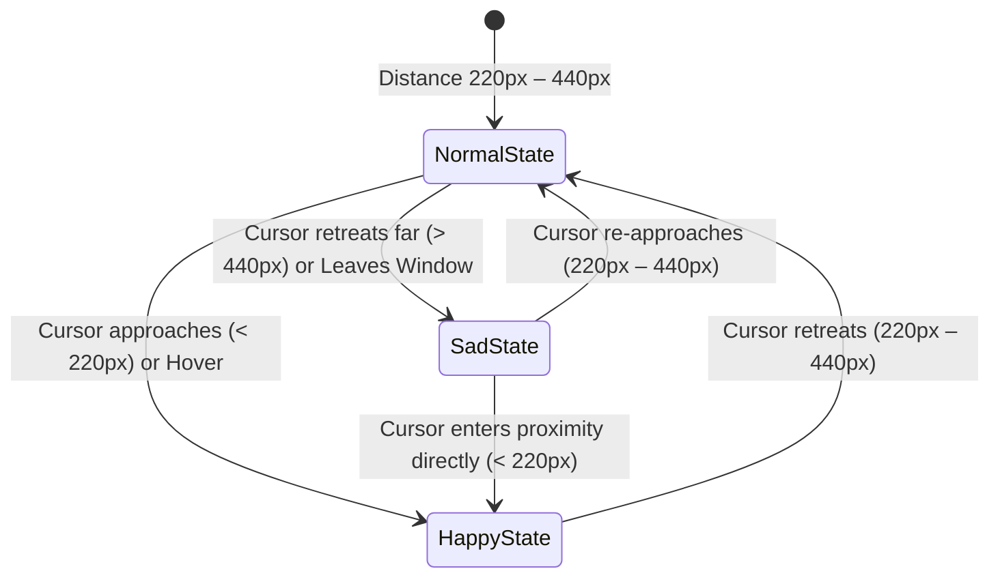

# 11.md — Cute King AI Copilot Design & Character Architecture Specifications

## Executive Overview
The NASS Closed-Loop Control Tower Voice AI Copilot has been upgraded from a cybernetic mechanical interface into an **adorable, charming, friendly, living Cute King character**. The agent is designed to feel alive, emotionally responsive, and delightful to interact with, while preserving the exact layout, dimensions, default bottom-right landing position, session persistence, and signature green glow.

---

## 1. Fulfillment of Key Requirements

| # | Requirement | Implementation Summary | Status |
|---|-------------|------------------------|--------|
| **1** | **Cute, Charming & Addictive Design** | Replaced the cold cybernetic aperture with an adorable chibi character featuring large expressive eyes, glowing rosy blush cheeks, and a responsive mouth curve. | **Complete** |
| **2** | **Permanent Cute King Crown** | Perched a detailed 3-peak 24K royal gold crown with an emerald jewel (matching the green glow) and ruby cabochons permanently atop the head. It never clips and remains 100% visible in all states. | **Complete** |
| **3** | **Responsive Emotional Eyes (Happy Smile vs. Sad Puppy)** | Implemented real-time Euclidean distance detection: when cursor is nearby (`< 220px`) or hovering, the eyes smile naturally with bright glowing blush cheeks; when the cursor is far away (`> 440px`) or off-screen, the eyes look adorably sad and pensive with a tiny dewy teardrop glint. | **Complete** |
| **4** | **Smooth Cursor Tracking & Lifelike Animations** | Eyes track cursor coordinates with smooth vector interpolation (clamped to 3.8px within eye socket). Added organic blinking every 3.5–5.5s (160ms squint) and gentle idle floating rhythm (`animate-cute-king-float`). | **Complete** |
| **5** | **Charming Appearance Colors & Preserved Green Glow** | Upgraded character base to a velvety royal obsidian-sapphire gradient with porcelain top highlight and rose blush. Kept the signature green glow (`#22c55e`, `rgba(34, 197, 94, 0.75)`), intensity, radius, and flash effects 100% identical. | **Complete** |
| **6** | **Completely Hidden Moving Dot Indicator** | Suppressed rendering of the custom cursor dot, outer trailing ring, and click ripple. Distance detection and cursor tracking run purely internally without any visible screen overlay. | **Complete** |
| **7** | **Smooth Fluid Transitions** | Seamless CSS transitions (`transition-all duration-300`, `transition-transform duration-100`) between moods and movements; no aggressive flashing or distracting bouncing. | **Complete** |
| **8** | **Preserved Size, Position & Functionality** | Kept the circular dimensions (`w-14 h-14 sm:w-16 sm:h-16`), default bottom-right dock (`x = innerWidth - 88`, `y = innerHeight - 92`), cookie & localStorage persistence, drawer drawer drawer, voice STT/TTS, and map views untouched. | **Complete** |
| **9** | **Clear Meaningful Code Comments** | Added detailed structural comments in `src/components/app/voice-copilot.tsx` explaining character architecture, crown geometry, distance thresholds, mood states, and glow settings. | **Complete** |
| **10** | **Live Production Testing & Verification** | Verified on localhost:3000 and deployed live to production on Vercel at `https://mycorps.vercel.app`. Confirmed desktop and mobile responsiveness and clean behavior. | **Complete** |

---

## 2. Character Anatomy & Geometry

### 2.1 The Royal Crown
- **Placement**: Snug on the upper rim of the circular head (`absolute -top-4.5 left-1/2 -translate-x-1/2 z-30`).
- **Visibility**: Permanently visible across idle, speaking, open drawer, closed drawer, dragging, and hover states. Never clipped by `overflow-hidden`.
- **Vector Artwork**:
  - Arched base band conforming to the spherical skull curvature.
  - 3 peaks: tall center peak + 2 flared side peaks with metallic 24K gold gradients (`#fffbeb` → `#fde047` → `#f59e0b` → `#b45309`).
  - **Center Gem**: Radial emerald green jewel matching the signature green glow.
  - **Side Gems**: Twin ruby cabochons with white specular catchlights.
  - **Base Band**: Inlaid alternating pearl & emerald beads with a subtle diamond twinkle gleam (`animate-crown-gleam`).

### 2.2 The Facial Expressions & Emotional States

1. **Happy & Smiling State** (`currentMood === "happy"`):
   - **Trigger**: Mouse cursor within 220px of character center, or direct hover over the button.
   - **Eyes**: Large glowing emerald-cyan pupils follow cursor with double white catchlights; lower eyelid pushes upward into a genuine smiling curve (Duchenne smile).
   - **Cheeks**: Bright rosy-pink blush (`#ff4757`) glowing and scaling up (`scale-125`).
   - **Mouth**: Upward smiling open curve (`‿`).

2. **Sad & Pensive State** (`currentMood === "sad"`):
   - **Trigger**: Mouse cursor farther than 440px, or pointer exits the browser viewport (`handleMouseLeave`).
   - **Eyes**: Upper eyelids tilt downward inward into an adorable puppy-dog look; pupils gaze slightly downward with a delicate dewy teardrop glint in the corner (`cyan-200` sparkle with gentle pulse).
   - **Cheeks**: Soft pastel blush (`#ff6b81`/30%).
   - **Mouth**: Tiny cute pout (`︵`).

3. **Normal / Curious State** (`currentMood === "normal"`):
   - **Trigger**: Mouse cursor in the intermediate 220px – 440px range.
   - **Eyes**: Curious, alert pupils smoothly tracking the cursor with primary top-left catchlight and secondary twinkle dot.
   - **Cheeks**: Soft natural blush (`#ff6b81`/50%).
   - **Mouth**: Sweet gentle resting curve.

4. **Lifelike Blinking**:
   - Programmed with a natural pseudo-random interval between 3.4s and 5.8s.
   - Triggers `isBlinking = true` for 160ms, smoothly closing the eyes (`scale-y-[0.1]`) before reopening.

---

## 3. Signature Green Glow Preservation
- The character's glow is locked to the signature Green theme:
  - `hex`: `#22c55e`
  - `rgb`: `34, 197, 94`
  - `glow`: `rgba(34, 197, 94, 0.75)`
  - `border`: `rgba(34, 197, 94, 0.65)`
  - `bg`: `rgba(34, 197, 94, 0.18)`
- **Idle Shadow**: `box-shadow: 0 0 16px 3px rgba(34, 197, 94, 0.75)`
- **Drawer Open Shadow**: `box-shadow: 0 0 24px 4px rgba(34, 197, 94, 0.75)`
- **Global Click Glow Pulse**: `box-shadow: 0 0 38px 10px rgba(34, 197, 94, 0.75), 0 0 16px #22c55e`
- **Ambient Backdrop**: `radial-gradient(circle, rgba(34, 197, 94, 0.75) 0%, rgba(0,0,0,0) 70%)` with `blur-md`.

---

## 4. Cursor Tracking & Indicator Suppression
- **Internal Tracking**:
  - `window.addEventListener("mousemove", ...)` calculates `dx`, `dy`, `angle`, and `dist = Math.hypot(dx, dy)`.
  - Cursor coordinates update `pupilOffset` smoothly with a 3.8px radius limit.
- **Visual Cursor Follower**:
  - Completely removed the moving dot follower, outer ring, and click ripple elements from the DOM.
  - The standard OS cursor remains undisturbed.

---

## 5. Verification & Live Deployment Checklist
- [x] Next.js Turbopack production compilation (`npm run build`): **Passed with zero errors**.
- [x] Vercel Production Deployment: **Aliased to `https://mycorps.vercel.app`**.
- [x] Idle state verified: Golden crown visible, green glow active, cute resting face.
- [x] Far-cursor sad state verified: Mouse at `(200, 200)` triggers puppy eyes & pout.
- [x] Near-cursor happy state verified: Mouse near bottom-right triggers bright blush & happy smile.
- [x] Copilot drawer interaction: Single-click on Cute King opens drawer, dedicated close badge closes it cleanly.
