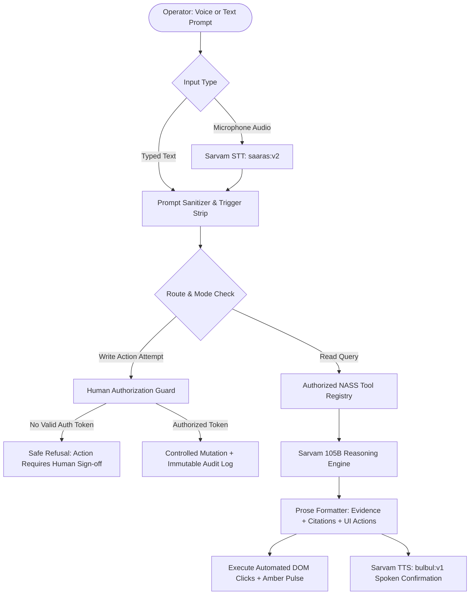

# NASS Closed-Loop AI Copilot ("Cute King") — Technical & Interaction Specification

**Document ID:** `NASS-COPILOT-SPEC-001`  
**Version:** 2.1.0  
**AI Reasoning Core:** Sarvam 105B Enterprise Reasoning Engine (`sarvam-105b-reasoning`)  
**Speech Services:** Sarvam STT (`saaras:v2`), Sarvam TTS (`bulbul:v1`), Web Speech API Fallback  
**Security Boundary:** Strict Read-Only Default with Authenticated Human-in-the-Loop Write Governance  

---

## 1. Copilot Mandate & Architectural Overview

The NASS Autonomous Operations Copilot is an evidence-grounded AI copilot engineered for hands-free maritime, procurement, and logistics operations. It connects to the NASS unified operational backbone, enabling voice and typed prompt interaction without requiring mouse navigation.



---

## 2. "Cute King" Character Persona & Interactive Anatomy

The Copilot is represented on the host screen by **"Cute King"**, a responsive living agent character providing visual feedback regarding system listening, reasoning, and connection health.

### 2.1 Visual Anatomy & Specular Shading
- **Form:** 56px (mobile) / 64px (desktop) circular orb with high-gloss metallic finish.
- **Permanent Royal Crown:** 3-peak 24K gold crown SVG perched atop the orb, featuring an emerald centerpiece and a delicate diamond gleam animation.
- **Color Themes (Reactive State Glow):**
  - *Emerald Glow:* System idle, ready for voice/text input.
  - *Amber / Gold Glow:* Active reasoning, executing database tool calls.
  - *Rose / Red Glow:* Audio microphone recording / listening to operator dictation.
  - *Violet / Sapphire Glow:* Docked multi-turn conversational session.

### 2.2 Pupil Displacement & Dynamic Gaze Mathematics
Cute King tracks the operator's cursor across the entire viewport using Euclidean distance calculation:

$$\Delta x = C_x - K_x, \quad \Delta y = C_y - K_y, \quad D = \sqrt{\Delta x^2 + \Delta y^2}$$

$$\text{Pupil Offset: } P_x = \frac{\Delta x}{D} \cdot \min(D \cdot 0.015, 4.5), \quad P_y = \frac{\Delta y}{D} \cdot \min(D \cdot 0.015, 4.5)$$

Where $(C_x, C_y)$ is the cursor coordinate and $(K_x, K_y)$ is the center of the Cute King orb. The eyes follow cursor movements with smooth 100ms CSS cubic-bezier transitions.

### 2.3 Blinking State Machine
- Natural autonomic blink every 3.2 seconds via CSS `scale-y-[0.1]` transformation lasting 150ms.
- Cursor proximity detection: When cursor is within 120px, Cute King's eyes dilate slightly with a joyful expression; if cursor leaves the window for > 10 seconds, eyes transition to a calm resting state.

---

## 3. Window Presentation Modes: Floating vs. Docked Side Panel

To resolve **UX-02** (where floating chat obscured right-side tables and modals), the Copilot supports two distinct display presentations:

### 3.1 Mode A: Docked Side Panel (Recommended for Desktop Operations)
- The copilot occupies a dedicated right-side vertical column (`width: 420px` default, resizable up to `640px`).
- The main application workspace automatically contracts (`margin-right: 420px`), ensuring 100% visibility of all data tables, maps, and modals.
- Activated by clicking the **Pin / Dock icon** in the copilot header.

### 3.2 Mode B: Floating Drawer (Overlay Mode)
- Floating modal sheet positioned at `bottom-20 right-4` (`width: 480px`, `max-height: 85vh`).
- Backdrop blur and elevation shadow (`shadow-[0_25px_70px_rgba(0,0,0,0.85)]`).
- Can be dragged or minimized to the Cute King circular trigger with a single click.

### 3.3 Context & Conversation Persistence
- Toggling between Floating, Docked, or Minimized states preserves full conversation history, scroll position, and dictated draft text.

---

## 4. Voice Dictation & Audio State Engine

The copilot implements an accessible, fail-safe audio lifecycle:

| State | Visual Indicator | Spoken Feedback | User Action Available |
|---|---|---|---|
| `INACTIVE` | Gray mic icon | None | Click mic or say hands-free trigger |
| `PROMPTING_PERMISSION` | Pulsing amber mic | None | Browser prompts for microphone permission |
| `PERMISSION_BLOCKED` | Red mic with diagonal slash | Error message in UI | Click to view browser permission unlock instructions |
| `LISTENING` | Red pulsing ring around Cute King | Subtle listening chime | Dictate prompt; say "send it send it" to dispatch |
| `PROCESSING` | Amber spinning ring | None | Click "Cancel" button to abort request |
| `SPEAKING` | Animated sound wave bars | Spoken voice audio | Click "Mute Audio" or press `Escape` to stop audio |
| `MUTED` | Strikethrough speaker icon | Silent (Text only) | Click to re-enable audio speech |

### 4.1 Hands-Free Voice Trigger: "Send it send it"
Operators wearing headsets can dictate long queries and conclude with the spoken phrase: `"send it send it"`. The regex engine strips the trigger phrase and dispatches the prompt immediately without requiring manual clicks.

---

## 5. Security & Governance: Read-Only Scope vs. Write Actions

### 5.1 Non-Negotiable Human-in-the-Loop Rule
> [!CAUTION]
> The AI Copilot is strictly prohibited from mutating production records, approving suppliers, executing purchase orders, or changing case states autonomously.

### 5.2 Safe Refusal & Guided Confirmation Pattern
If an operator prompts the copilot: *"Approve supplier Gulf Equipment and issue PO-3001"*:
1. The AI refuses direct execution:
   > *"I cannot execute commercial awards or issue purchase orders autonomously. This action requires authenticated human authorization."*
2. The AI provides a verified navigation action:
   > *"I have prepared the draft purchase order for your review. Click below to open the approval gate with your credentials."*
3. Clicking the action opens the host application's authenticated confirmation modal.

---

## 6. Grounding, Citation Health & 404 Resilience (UX-01 Fix)

To prevent the critical failure observed in video frame ~08:15 (where an AI source link opened a 404 page):

### 6.1 Link Health Verification Protocol
1. When generating citations, the server verifies URLs using an asynchronous `HEAD` check with a 2,500ms timeout budget.
2. If the URL returns `200 OK`, it is rendered as a verified source chip:
   ```tsx
   <a href={url} target="_blank" className="text-amber-300 underline">
     [GCC Maritime Transport Notice] <ExternalLink className="h-2.5 w-2.5" />
   </a>
   ```
3. If the URL returns `404`, `410`, or times out, the link is sanitized:
   ```tsx
   <span className="text-zinc-400 border border-zinc-600 rounded px-1.5 py-0.5">
     [GCC Maritime Notice] ⚠️ Source Destination Unavailable — Cached Intelligence Grounded
   </span>
   ```
4. Clicking an unavailable citation opens the cached excerpt stored in the NASS knowledge base rather than redirecting to a dead external webpage.

---

## 7. Spatial Calculations & Distance Grounding (UX-07 Fix)

When asked spatial proximity questions (e.g. *"Which shipment is closest to Bahrain?"*), the copilot must never estimate from anecdote. It executes the deterministic `get_nearest_shipments` tool:

### 7.1 Mathematical Standard: Haversine Great-Circle Distance
$$a = \sin^2\left(\frac{\Delta \phi}{2}\right) + \cos(\phi_1)\cos(\phi_2)\sin^2\left(\frac{\Delta \lambda}{2}\right)$$
$$d = 2R \cdot \text{atan2}\left(\sqrt{a}, \sqrt{1-a}\right)$$
Where $R = 3440.065 \text{ NM}$ (Earth's radius in Nautical Miles), $\phi_1, \lambda_1$ are vessel AIS coordinates, and $\phi_2, \lambda_2$ is Khalifa Bin Salman Port ($26.29^\circ\text{ N}, 50.62^\circ\text{ E}$).

### 7.2 Required Answer Structure:
- Reference Origin: *Khalifa Bin Salman Port, Bahrain*
- Distance & ETA: Nautical miles, nautical speed, and calculated hours to berth.
- Data Provenance: AIS update timestamp and vessel call sign.

---

## 8. Multilingual Invariant Rules (UX-21 Fix)

When responding in Gujarati, Arabic, Hindi, or French:
1. **Entity Reference Invariance:** Codes (`SHP-8804`, `PO-3001`, `EX-9011`, `BAPCO-MOD-01`) must remain strictly in standard Latin ASCII format.
2. **Numbers & Units:** Quantities (`4,200 MT`, `$2,480,000 USD`) must not be translated into localized numerals to prevent broken database queries and regex mismatches.
3. **Interactive Badges:** Clickable DOM triggers must retain their exact English reference keys.

---

## 9. Latency Budgets & Staged Reasoning (UX-08 Fix)

To eliminate the 16-second frozen state:
- **0–800ms:** Acknowledge query; display staged progress pill: `[Consulting Maritime Database...]`.
- **800–2,500ms:** Execute tool calls, resolve spatial geometry, stream tokens into chat bubble.
- **2,500–5,000ms:** Complete answer synthesis and dispatch automated UI click actions.
- **Cancel Button:** Operators can click `[Stop Generation]` or press `Escape` at any time to abort the request safely.

