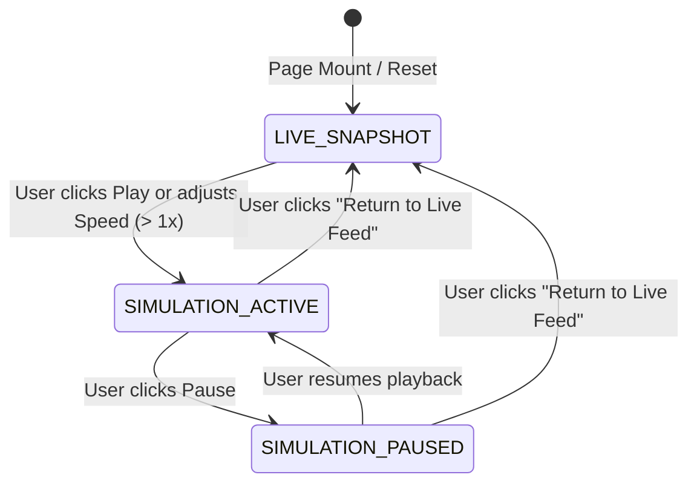
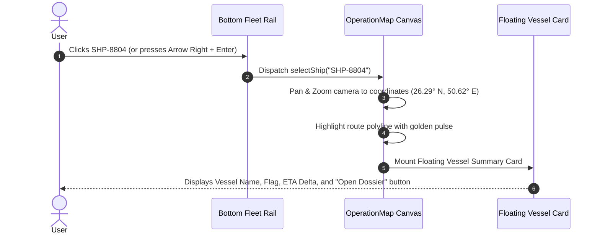

# NASS Freight Traceability & Shipment Dossier Specification

**Document ID:** `NASS-MAP-DOS-001`  
**Version:** 2.0.0  
**Domain:** Maritime Logistics, Vessel Telemetry, AIS Intelligence & Customs Clearance  
**Reference Components:** `LiveTraceabilityView`, `OperationMap`, `ShipmentDetailsModal`  

---

## 1. Live vs. Simulation State Separation (UX-04 Fix)

To prevent the operational hazard of confusing real-time vessel positions with hypothetical time-lapse simulations:

### 1.1 State Definition & Visual Contract



### 1.2 Persistent Status Banners
- **Live Snapshot Mode:**
  - *Banner Color:* Emerald Green (`bg-emerald-950/80 border-emerald-500/40 text-emerald-300`).
  - *Visible Copy:* `[🟢 LIVE SNAPSHOT] Authoritative AIS Feed · Synced: 2026-10-29 01:00 UTC · Next update in 42m`.
  - *Semantics:* Positions represent verified real-world satellite/terrestrial AIS reports.
- **Scenario Simulation Mode:**
  - *Banner Color:* High-visibility Amber / Caution Stripe (`bg-amber-950/90 border-amber-500/60 text-amber-200`).
  - *Visible Copy:* `[🔶 SCENARIO SIMULATION ACTIVE] Time-Lapse Factor: 60x | Virtual Offset: +4.5h | Real-Time Feeds Suspended`.
  - *Action Button:* High-contrast button `[Return to Live Feed (Escape)]` immediately resets virtual clock to real-world time.

---

## 2. Accessible Route Legends & Dual-Encoding (UX-10 Fix)

Vessel markers and route polylines avoid relying solely on hue, complying with WCAG 2.2 Level AA:

### 2.1 Route Polyline & Marker Taxonomy

| Status | Marker Color | Stroke Style | Associated SVG Icon | Tooltip Definition |
|---|---|---|---|---|
| `IN_TRANSIT` | `#38bdf8` (Sky) | Solid 2.5px | `<Ship />` | Vessel underway under engine, on schedule |
| `DELAYED` | `#f43f5e` (Rose) | Dashed 3.0px (`dashArray: 6, 6`) | `<AlertTriangle />` | Vessel delayed > 24h past scheduled ETA |
| `CUSTOMS_HOLD` | `#f59e0b` (Amber) | Dotted 3.0px (`dashArray: 2, 6`) | `<ShieldAlert />` | Vessel held at anchorage / customs barrier |
| `AT_PORT` | `#a855f7` (Violet) | Double line | `<Anchor />` | Vessel berthed at port quay |
| `ARRIVED` | `#10b981` (Emerald)| Solid 2.0px dim | `<CheckCircle2 />` | Voyage completed; cargo discharged |

---

## 3. Map & Fleet Rail Bidirectional Synchronization

Selecting a vessel anywhere in the interface synchronizes the entire screen state atomically:



### 3.1 Keyboard Accessibility on Map
- Pressing `Tab` focuses through the bottom fleet rail items sequentially.
- Pressing `Enter` or `Space` selects the highlighted vessel, focuses the camera, and opens the floating details card.
- Pressing `Escape` closes the vessel card and resets camera focus.

---

## 4. Stale AIS Feeds & ETA Uncertainty Handling (UX-15 / UX-19 Fix)

When satellite tracking drops or terrestrial AIS transponders encounter dead zones:

### 4.1 Freshness Hierarchy
- **Fresh Feed (< 60 minutes):** Display green dot with exact elapsed time (`Updated 14m ago`).
- **Stale Warning (60 minutes – 6 hours):** Display amber warning pill: `[⚠️ AIS Stale: Last signal 3.4h ago via Inmarsat-C]`.
- **Signal Lost (> 6 hours):** Display high-priority alert on the vessel card: `[Dead Reckoning Estimate: Satellite Feed Interrupted]`. The vessel marker changes to semi-transparent dashed outline to prevent false precision.

### 4.2 ETA Confidence Intervals
ETAs are never rendered as guaranteed points in time; they express confidence:
- *High Confidence (> 90%):* `ETA: 29 Oct 14:30 UTC (±1h)`
- *Moderate Uncertainty (Weather / Port Congestion):* `ETA: 30 Oct 08:00 UTC (Estimated window: 29 Oct 22:00 – 30 Oct 16:00)`.

---

## 5. Complete 10-Section Shipment Dossier Architecture (UX-03 Fix)

The complete shipment dossier (`ShipmentDetailsModal.tsx`) organizes dense maritime trade documentation into 5 grouped categories:

```
Complete Shipment Dossier (SHP-8804)
├── Group A: Overview & Cargo
│   ├── Section 1: Shipment Overview (Ref, Type, Live Status, Vessel, Voyage)
│   └── Section 2: Cargo Manifest (SKU, HS Code, Quantity, Gross Weight)
├── Group B: Valuation & Packaging
│   ├── Section 3: Valuation & Cost (Declared Value, Freight Charges, FX Rates)
│   └── Section 4: Packaging & Weight (Container No, Tare Weight, Dimensions)
├── Group C: Stakeholders & Route
│   ├── Section 5: Associated Companies (Consignee, Shipper, Notify Party)
│   └── Section 6: Route & Ports (Port of Loading, Port of Discharge, AIS Waypoints)
├── Group D: Compliance & Documents
│   ├── Section 7: Customs & Clearance (Declaration No, Inspection Pass, Holds)
│   └── Section 8: Trade Documents (Bill of Lading, Certificate of Origin, GRN)
└── Group E: History & Risks
    ├── Section 9: Milestone History (Event Log, Speed Logs, Port Checkpoints)
    └── Section 10: Charges, Demurrage & Risks (Free days remaining, Hazard score)
```

### 5.1 Responsive Sub-Navigation Bar
Instead of 10 cut-off horizontal tabs, the dossier uses a 5-pill grouped bar with responsive wrapping:
```tsx
<div className="flex flex-wrap items-center gap-1.5 px-5 py-2.5 border-b border-border/40 bg-card/60">
  <button onClick={() => scrollTo("overview")}>1. Overview &amp; Cargo</button>
  <button onClick={() => scrollTo("valuation")}>2. Valuation &amp; Packaging</button>
  <button onClick={() => scrollTo("companies")}>3. Stakeholders &amp; Route</button>
  <button onClick={() => scrollTo("customs")}>4. Compliance &amp; Documents</button>
  <button onClick={() => scrollTo("timeline")}>5. History &amp; Demurrage</button>
</div>
```

---

## 6. Audited PDF Export Pipeline

The PDF export button triggers `/api/live-trace/report?ref=SHP-8804` to generate an enterprise-grade clearance document:

### 6.1 Report Document Layout
1. **Header Banner:** NASS Industrial Group corporate logo, document security classification (`CONFIDENTIAL — OPERATIONAL DISPATCH`), generation timestamp in UTC and Bahrain Local Time (`Asia/Bahrain`).
2. **Executive Summary:** Vessel identity, IMO number, Master Bill of Lading, Consignee entity (`NASS Contracting WLL`), and declared destination port.
3. **Itemized Cargo Schedule:** High-resolution tabular schedule with HS codes, net metric tonnage, and package quantities.
4. **Commercial Valuation & FX Table:** Declared CIF value, breakdown of ocean freight charges, and applicable Central Bank of Bahrain FX conversion rate.
5. **Cryptographic Provenance Stamp:** SHA-256 hash of the database snapshot, authorized operator signature block, and verifiable QR code pointing to `/verify-dossier?hash=...`.

### 6.2 Fail-Safe Generation
If PDF rendering encounters an error, the system does not crash or silently fail. It surfaces an inline dialog with a direct CSV export fallback and a technical retry button.

