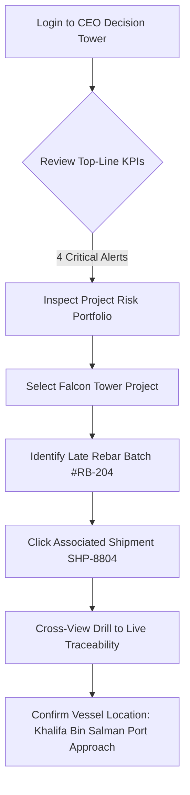
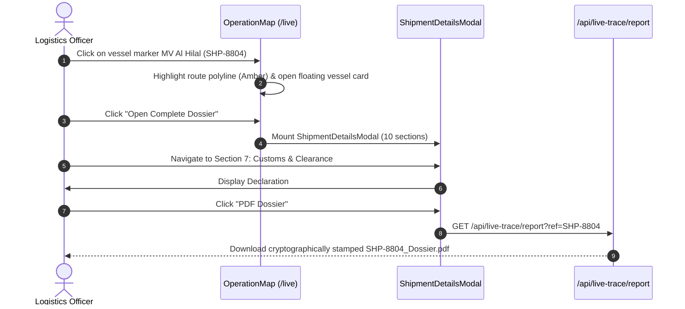
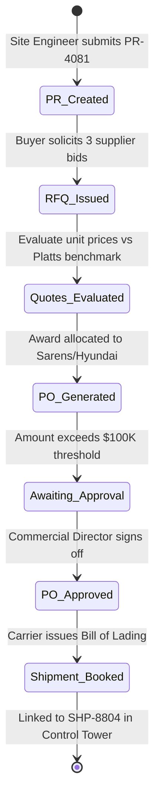
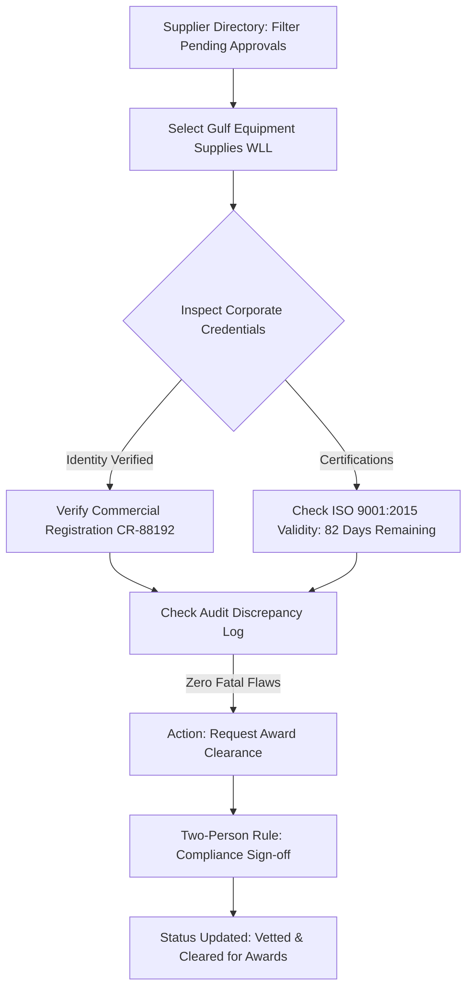
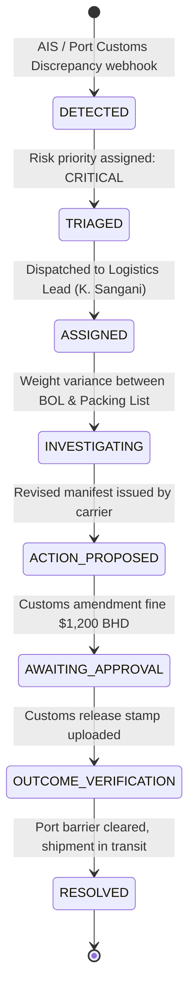
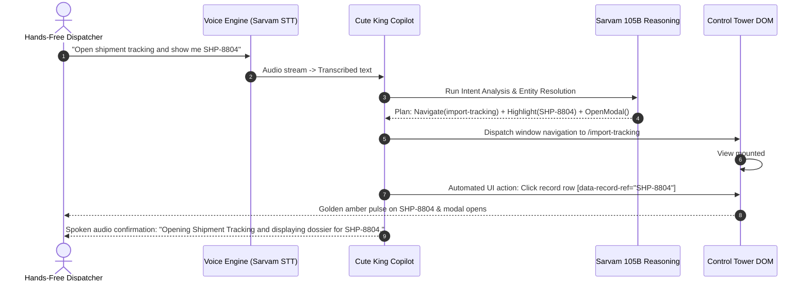

# NASS Control Tower — Core Enterprise UX Journeys & Workflows

**Document ID:** `NASS-UX-JRN-001`  
**Application:** NASS Executive Control Tower  
**Target Personas:** Chief Executive Officer, Logistics Operations Director, Senior Procurement Specialist, Compliance Auditor  
**Evidence Baseline:** `x-compressed.mp4` (12:02.9) & Tested Next.js App Router Architecture  

---

## Journey 1: Executive Triage & Portfolio Risk Intervention

### Persona: Chief Executive Officer / Chief Operating Officer
**Primary Goal:** Within 60 seconds of morning login, identify critical material or maritime bottlenecks impacting high-value Bahrain construction projects, evaluate risk exposure, and trigger operational drilldowns without manual spreadsheets.

### Step-by-Step Interaction Specifications:
1. **Initial Assessment (00:00–00:30):**
   - User reviews the 4 decision-grade KPI cards: Active Projects (12), Total Material Spend ($48.2M), Vessels at Risk (3), Open Exceptions (14).
   - Freshness indicators show `fresh · synced 4m ago`.
2. **Project Portfolio Inspection (00:30–00:50):**
   - User hovers over project card **"Falcon Tower — Mixed Use Development"**.
   - Notice: Structural steel schedule slip of +5 days due to customs hold at origin.
   - User clicks the embedded badge `SHP-8804 (Rebar & Steel)`.
3. **Contextual Cross-View Drill (00:50–01:09):**
   - The application preserves active filters and transitions via `useAppStore.drillTo("live", "SHP-8804")`.
   - The system transitions directly to the Live Freight Traceability map with camera centered on the active vessel `MV Al Hilal`.
4. **Outcome & Next Step:**
   - The CEO has zeroed in from a $48M portfolio overview to the exact vessel carrying delayed materials in under 4 clicks.

---

## Journey 2: Maritime Selection → Complete Shipment Dossier → Audited PDF Export

### Persona: Import Logistics Coordinator / Port Clearance Agent
**Primary Goal:** Inspect vessel voyage data, cargo manifests, declared valuations, and generate an audited customs clearance dossier for port authorities.

### Step-by-Step Interaction Specifications:
1. **Vessel Discovery on Maritime Canvas (01:10–02:42):**
   - The user opens Live Traceability. The interactive map renders 8 commercial vessels inbound to Bahrain.
   - User clicks `SHP-8804` in the bottom fleet rail or clicks the vessel SVG icon on the map.
   - The map centers coordinates `26.29° N, 50.62° E` (Approach to Mina Salman / Khalifa Bin Salman Port).
2. **Dossier Activation (02:43–03:05):**
   - User clicks **"Open Complete Dossier"**.
   - The 10-section dossier modal opens over the map.
   - User uses the sticky sub-navigation bar to jump directly between:
     - *Overview:* Vessel Voyage `VOY-992B`, IMO `9418291`, Flag `Bahrain`.
     - *Manifest:* 4,200 MT High-Tensile Deformed Steel Rebar (Grade 60, ASTM A615).
     - *Valuation:* Total declared value `$2,480,000 USD` (BHD 935,000 eq.).
     - *Customs:* Document discrepancy flag on commercial invoice weight mismatch.
3. **Audited PDF Generation:**
   - User clicks **"PDF Dossier"**.
   - An asynchronous download request triggers `/api/live-trace/report?ref=SHP-8804`.
   - A multi-page executive report is generated with server timestamp, AIS coordinates, manifest breakdown, and authenticated QR verification code.

---

## Journey 3: Procurement Lifecycle: PR → RFQ → PO → Supplier Allocation → Dispatch

### Persona: Senior Procurement Specialist / Buyer
**Primary Goal:** Convert an engineering requisition into an authorized purchase order with an accredited brand partner and track commercial fulfillment.

### Step-by-Step Interaction Specifications:
1. **Requisition Triage (04:10–04:38):**
   - Procurement Officer filters `/procurement` by `Pending Requisitions`.
   - Locates `PR-4081` for structural hydraulic pumps requested by the Marine Contracting division.
2. **Supplier Sourcing & Benchmarking (04:40–05:13):**
   - Navigates to `/suppliers` -> Tab 2: *Price Intelligence & Market Benchmarks*.
   - Compares the quoted rate against the Platts & MEED spot index.
   - Identifies an approved brand partner (**CASE Construction / Hyundai**) with an active -9.8% group volume discount contract.
3. **Purchase Order Issuance & Approval Gate:**
   - Officer generates `PO-3088` totaling `$184,000 USD`.
   - The system intercepts the transaction with an **Approval Gate**:
     > `NOTICE: Spend exceeds $100,000 threshold. Authenticated human authorization required from Authorized Signatory.`
   - Commercial Director approves using biometric or two-factor credential confirmation.
4. **Logistics Dispatch Linking:**
   - Once approved, the PO automatically links to incoming shipment `SHP-8804`.
   - Real-time milestone updates begin streaming from the freight forwarder API.

---

## Journey 4: Supplier Vetting, Classification & Award Clearance

### Persona: Vendor Quality Manager / Compliance Officer
**Primary Goal:** Evaluate a candidate supplier’s corporate credentials, verify certifications, and transition them from probationary to award-cleared status.

### Step-by-Step Interaction Specifications:
1. **Directory Inspection:**
   - User visits `/suppliers` -> Tab 3: *All Network Suppliers*.
   - Filter by status `PENDING` (displays purple warning pill: `approval required before award`).
2. **Credential Audit:**
   - User reviews the supplier’s legal registration, tax identity, and safety score (94.2%).
   - The system displays the `Data Verified: 100% (Corporate Records)` badge.
   - An inline tooltip clarifies: *"Data Verified indicates that corporate registry records are authentic. Operational award requires independent procurement governance sign-off."*
3. **Award Authorization:**
   - Officer clicks **"Clear for Award"**.
   - A modal requires selecting the allowed spend tier (Tier 1: < $50K, Tier 2: < $250K, Tier 3: Unlimited).
   - System registers the change in the immutable audit log with user email, timestamp, and signed certificate hash.

---

## Journey 5: Closed-Loop Exception Diagnosis → Resolution → Verification

### Persona: Logistics Director / Operations Dispute Officer
**Primary Goal:** Resolve a high-priority customs hold (`EX-9011`) on incoming vessel cargo, assign ownership, submit verified proof documents, and close the exception with auditable verification.

### Step-by-Step Interaction Specifications:
1. **Exception Queue Alert (09:20–10:09, 10:10–11:06):**
   - The user opens `/exceptions` or navigates via Copilot to case `EX-9011`.
   - Title: *Customs Documentation Discrepancy — High Tensile Rebar*.
   - Related Object: `SHP-8804` / `MV Al Hilal`.
2. **Investigation & Root-Cause Diagnosis:**
   - The split-pane interface shows:
     - Manifest gross weight: `4,218.40 MT`.
     - Port bill of lading gross weight: `4,200.00 MT`.
     - Variance: `18.40 MT` (dunnage & securing lashings omitted in original declaration).
3. **Corrective Action & Human Approval:**
   - Officer attaches the amended packing list signed by the carrier.
   - Action proposed: *Submit Amended Customs Declaration with Supplementary Lashings Weight*.
   - A human confirmation dialog appears:
     > `Confirm State Transition: INVESTIGATING -> ACTION_PROPOSED`  
     > `Actor: K. Sangani (Logistics Operations Lead)`  
     > `Evidence Attached: DOC-BHR-REV4.pdf`
4. **Verification & Closed-Loop Closure:**
   - Port customs confirms receipt; release note issued.
   - Officer transitions state to `RESOLVED`.
   - The live counter updates atomically: Active exceptions decrease from 14 to 13.
   - An immutable event entry is appended to the case timeline with timestamp, actor, and hash.

---

## Journey 6: Hands-Free AI Voice Copilot Operator Navigation

### Persona: Hands-Free Operations Dispatcher (Voice / Multi-Tasking)
**Primary Goal:** Operate the entire control tower using spoken natural language prompts while monitoring physical screens or coordinating field dispatch.

### Step-by-Step Interaction Specifications:
1. **Spoken Intent & Voice Dictation (05:14–08:45, 11:57–12:03):**
   - Dispatcher speaks into headset: *"Which vessels are currently delayed inbound to Bahrain and what is the nearest shipment?"*
   - Cute King agent’s eyes illuminate with dynamic amber ring; Sarvam STT transcribes in real-time.
2. **Reasoning & Spatial Math Calculation:**
   - Copilot determines reference origin: **Khalifa Bin Salman Port, Bahrain (26.29° N, 50.62° E)**.
   - Calculates haversine distance to all 8 ships using verified AIS positions.
   - Ranks shipments by nautical miles and hours to port.
3. **Honest Evidence Presentation & External Citation:**
   - Displays clear answer with clickable record badges: `SHP-8802 (42 NM)`, `SHP-8804 (118 NM)`.
   - Renders external maritime news citation with pre-verified link status:
     - If verified: `[GCC Maritime Port Notice](https://...)`
     - If link returns 404/410: `[GCC Maritime Port Notice] ⚠️ Destination Unreachable — Displaying Cached Intelligence Summary`.
4. **Automated Compound UI Action:**
   - Operator says: *"Open Exceptions and click on EX-9011"*.
   - Copilot navigates to `/exceptions`, locates the row for `EX-9011`, and triggers a simulated click with an amber visual pulse.
   - No mouse or keyboard input required.

