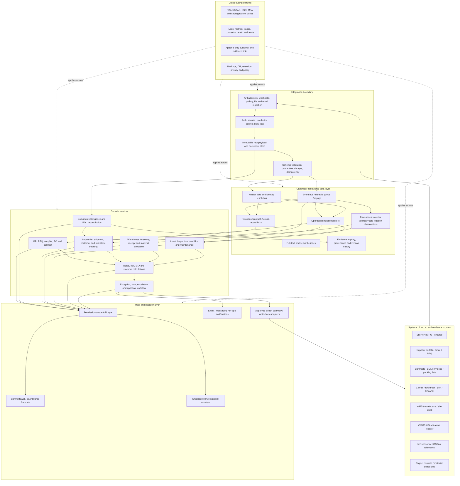

# NASS Closed-Loop Supply Chain Intelligence — Skill File

## 1. Purpose

Use this skill to design a practical, closed-loop operational intelligence system for a construction, EPC, contracting, industrial, or multi-site organization such as NASS. The system should connect procurement requests, suppliers, contracts, purchase orders, import documents, shipments, containers, vessel/location feeds, warehouse stock, receiving, project material demand, equipment/assets, inspections, maintenance, alerts, tasks, approvals, and verified outcomes.

The intended outcome is a **single operational view backed by connected source records**, not an AI chatbot placed on top of disconnected data. Every operational alert must be traceable to evidence, assigned to an owner, worked through an approved action, and closed only after the outcome is verified.

This file defines a target architecture and a reusable instruction set. It is **not proof that every proposed module is already built or deployed by StellarMind**. Public platform descriptions and case studies are mapped in Section 18. Use explicit evidence labels whenever describing capability maturity.

## 2. Operating context to use as design input

The following points are reported from a discussion with a NASS representative, Antoine, and should be treated as conversation inputs rather than independently verified company-wide facts:

- Purchase requests may arrive through inconsistent channels.
- Procurement and contract steps require coordination across internal teams and suppliers.
- Sourcing and logistics may span international suppliers and shipments.
- Warehouse inventory may not be linked cleanly to purchase requests or project requirements.
- A bill of lading (B/L or BOL) may be missing a container number.
- Teams need to see which supplier is linked to which order or shipment, where the shipment was last reported, its latest expected arrival, and whether a delay will affect a project or warehouse.

Do not assume NASS uses a specific ERP, WMS, carrier, port community system, customs platform, IoT stack, or data standard until discovery confirms it. Do not assume all NASS legal entities, subsidiaries, projects, or business units share one system.

## 3. Non-negotiable design rules

1. **Evidence before assertion.** Every factual status, location, ETA, inventory quantity, supplier commitment, extracted document field, AI recommendation, and completed action must retain its source and timestamp.
2. **Separate evidence from design.** Label statements as `PUBLICLY EVIDENCED`, `PROPOSED TARGET CAPABILITY`, `REQUIRES CUSTOMER DATA/INTEGRATION`, `REQUIRES DEMO/VALIDATION`, or `NOT CONFIRMED`.
3. **Never manufacture live data.** Do not say a shipment is live-tracked unless an active feed, its update time, and the relevant shipment/container/vessel identity are available. Do not invent ETAs, GPS points, stock levels, supplier performance scores, or delivery dates.
4. **A vessel is not a container.** AIS usually reports vessel position. Do not infer a particular container's position from a vessel position unless a trustworthy shipment-to-vessel/container relationship is established by source records.
5. **Closed loop means verified outcome.** Detecting an exception or creating a task is not resolution. Close the case only after the source system or authorized user confirms the result.
6. **Human approval for consequential actions.** Never automatically approve a supplier, change a contract, release a purchase order, commit spend, change a delivery address, clear a customs hold, or send binding commitments without configured authority and explicit approval.
7. **Idempotency and deduplication.** Reprocessing the same email, BOL, webhook, shipment milestone, or ERP event must not create duplicate purchase orders, receipts, supplier records, cases, or notifications.
8. **Preserve history.** Never silently overwrite the original document, ETA, milestone, stock count, approval, or user correction. Keep version history and record who/what changed it and why.
9. **Show freshness and uncertainty.** Each live-looking field must expose source, `last_updated_at`, freshness status, and confidence/quality where applicable. A stale value must be labeled stale, not presented as current.
10. **Degrade safely.** If a provider, integration, model, database, or external API fails, show a truthful partial state, log the fault, queue retryable work, and route unrecoverable or ambiguous cases to a human queue.
11. **Least privilege.** Enforce company, legal entity, project, site, supplier, cost centre, and role permissions at the API/data layer, not only in the UI.
12. **Bounded scope.** Build one shared operational backbone and separately deployable modules. Do not create a separate AI agent for every screen or overbuild predictive AI before identifiers and source data are reliable.
13. **Deterministic rules for decisions.** Use versioned business rules for thresholds, reconciliation, escalation and approvals. Use LLMs for language, extraction assistance and explanations, never as the sole authority for high-impact status transitions.
14. **Explicit time semantics.** Store timestamps in UTC; preserve original timezone and source timestamp; render local time with timezone. Distinguish event time from ingestion time.
15. **No false precision.** A predicted arrival is a forecast with a model/source and confidence, not a guaranteed arrival. Display a point estimate only when justified; otherwise display a range or “not enough data.”

## 4. Instructions when using this skill

When asked to design or review the system:

1. Start with the concrete operational question and the workflow outcome, not a technology stack.
2. State assumptions and unknowns. Ask only for blockers; if enough is known, proceed with marked assumptions and a discovery checklist.
3. Produce a coherent end-to-end architecture, not disconnected module descriptions.
4. For every module, define purpose, users, inputs, source of truth, outputs, API/events, permissions, failure behavior, audit evidence, and acceptance tests.
5. Use the architecture in Section 7 as the default. Change it only when a documented constraint requires it.
6. Separate source-system facts, computed metrics, AI interpretations, and proposed actions in the data model and UI.
7. Include live import/shipment tracking and the complete BOL workflow explicitly. Do not bury them under a generic “document AI” or “logistics” label.
8. Include runtime failure/recovery paths, data freshness, replay, idempotency, and manual exception handling in every relevant sequence.
9. Avoid claiming any feature is production-ready based solely on a marketing page or case-study summary. Map claims to the evidence table in Section 18 and list required demonstrations.
10. Finish with module coverage, failure-path coverage, security coverage, and acceptance criteria. Perform two separate review passes as described in Section 20 before presenting the final result.

## 5. Target outcomes and operating questions

The system should help authorized users answer questions such as:

- Which purchase requests are waiting for clarification, approval, sourcing, a purchase order, shipment, or receipt?
- Which suppliers are connected to each PR, RFQ, contract, PO, item, shipment, BOL, invoice, and delivery?
- Which shipment or container carries this material, and which project/site needs it?
- What is the latest **source-reported** location or milestone? Which provider reported it, and when?
- What is the latest carrier/freight-forwarder/port-system ETA? Is it confirmed, stale, forecast, or missing?
- Which shipments have slipped against supplier-confirmed ETD/ETA or the project-required date?
- Which delays create a stockout or threaten a construction/maintenance milestone?
- What stock is available, reserved, in transit, quarantined, damaged, or awaiting inspection at each warehouse/site?
- Which BOL is missing a container number, has inconsistent packages/weights, or does not reconcile with its PO, invoice, packing list, or arrival notice?
- Which assets have abnormal telemetry, missed inspection, open defects, expired certificates, upcoming maintenance, or missing spare parts?
- Who owns an exception, what action is pending, who must approve it, and what evidence proves closure?

## 6. Architecture principles and boundaries

### 6.1 One operational backbone; bounded modules

Use common identity, eventing, source connectors, canonical identifiers, evidence storage, audit, policy, and workflow services. Procurement, imports, BOL intelligence, shipment tracking, warehouse, assets, and supplier performance are bounded domain modules. They share identifiers and events rather than duplicating the same supplier, material, PO, shipment, or asset records.

### 6.2 Source of truth by data category

Establish the source of truth during discovery. A common pattern is:

- ERP/procurement system: approved suppliers, PRs, PO lines, accounting fields, commitments, GRNs and payment-relevant statuses.
- Contract repository/DMS: signed contracts, amendments and controlled versions.
- Carrier, freight forwarder, port, vessel/AIS or tracking provider: transport events and reported locations within that provider's coverage.
- WMS/ERP/site register: on-hand, allocated, reserved, quarantined, received and issued inventory.
- CMMS/EAM/asset register: asset identity, maintenance work orders and inspection records.
- IoT platform/historian: sensor measurements and device health.
- BOL/invoice/packing list/arrival notice: source documents for extracted shipping and trade fields.
- Workflow service: assignments, approvals, exception state and closure evidence.

These are proposed source-of-truth patterns, not assumptions about NASS's current software.

### 6.3 Read side and write side must be separated

Start with read-only connectors where possible. For every write-back connector, define allowed commands, data validation, permission check, approval policy, idempotency key, post-write verification, rollback/compensation path, and operator alerting. The system must not report a write as successful until the target system confirms it.

### 6.4 Prefer integration over rip-and-replace

Connect existing ERP, email, spreadsheets, procurement tools, WMS, CMMS, carrier/forwarder APIs and approved document stores before proposing replacements. Use adapters so an upstream application change does not rewrite business logic.

## 7. Reference architecture



### 7.1 Architecture interpretation

- The integration boundary receives and validates data; it must not perform undocumented business decisions.
- Raw source payloads and original documents are preserved for traceability, subject to retention policy.
- Canonical domain services own validated domain state; event consumers can be replayed safely.
- The graph links records across systems, while the relational store remains appropriate for transactions. Do not force every workload into a graph database.
- Time-series storage is for telemetry and location observations; it is not the only source of shipment state.
- AI provides extraction assistance, natural-language access, explanation, and prioritization. Deterministic rules validate critical state transitions.
- The action gateway is the only path for external write-backs and consequential notifications.
- Security, observability, audit, retention, backup and disaster recovery apply across all layers.

## 8. Canonical entities and relationship model

Create persistent canonical IDs independent of any supplier's or carrier's identifier. Retain all source-system IDs as aliases.

### 8.1 Core entities

1. **LegalEntity / BusinessUnit** — the NASS entity or operating unit that owns a transaction.
2. **Project / Site** — project code, site, required-on-site date, cost code, work package and material demand.
3. **Supplier / Vendor** — canonical supplier ID, registered names, aliases, locations, status, approved categories, terms, certifications and contacts.
4. **Material / SKU / Part** — canonical item ID, manufacturer part number, unit of measure, description, criticality, storage conditions and controlled aliases.
5. **PurchaseRequest (PR)** — requester, project/site, line items, quantity, required date, justification, channel, approval route, status and source reference.
6. **RFQ / SupplierResponse** — supplier invitation, quotation/version, currency, lead time, validity, price components, exceptions and evidence.
7. **PurchaseOrder (PO)** — supplier, legal entity, PO lines, quantities, currency, price, delivery terms, delivery location, milestones, amendments and line-level statuses.
8. **Contract / Obligation** — contract/amendment versions, parties, scope, clauses, committed dates, delivery terms, penalties, insurance/certification obligations and approval status.
9. **Shipment / ShipmentLeg** — shipment ID, related PO lines, shipper, consignee, forwarder, carrier, mode, origin/destination, handoff milestones, planned and actual dates.
10. **Container / Package / Seal** — container or package identifiers, size/type, seal, package count, weights, linked shipment/BOL and identification source. Support LCL and non-container freight without requiring a container ID.
11. **BillOfLading (BOL)** — document ID, BOL number, master/house type, issuer, version, issue date, shipper, consignee, notify party, vessel/voyage when present, ports/places, container/seal list, cargo marks, package count, gross/net weight, goods description, freight terms and referenced POs/invoices.
12. **ShippingDocument** — commercial invoice, packing list, certificate of origin, insurance document, import permit, customs declaration, arrival notice, delivery order, inspection/certification or other document type.
13. **TrackingObservation / ShipmentMilestone** — event code/type, location, source/provider, provider event ID, event time, ingestion time, source payload reference, confidence and correction/retraction links.
14. **ETAObservation** — value or range, source, estimate type (supplier, carrier, forwarder, port, model), calculated_at, valid-for-time, confidence and input lineage.
15. **Warehouse / Location / Bin** — site/warehouse/bin identity, allowed stock types and physical location hierarchy.
16. **InventoryLot / StockPosition** — item, quantity, UOM, condition/status, lot/batch, serials where applicable, warehouse/bin, owner/project reservation and last verified time.
17. **GoodsReceipt (GRN) / Inspection / Discrepancy** — PO line, shipment, BOL/packing-list references, received quantities, damage/shortage, photos, QC result, receiving time and approver.
18. **Asset / Equipment / Sensor** — asset ID, make/model/serial, site/location, owner, criticality, condition, meter, connected devices and source references.
19. **MaintenanceWorkOrder / Inspection / Certificate** — task type, due date, findings, defects, parts required, owner, approvals and closeout evidence.
20. **ExceptionCase / Task / Approval** — trigger, severity, owner, SLA, related entities, recommended action, approval state, due date, communications, resolution code and closure proof.
21. **SourceEvidence / DocumentVersion** — source URI/ID, content hash, received time, issuer, extraction version, confidence by field, original/derived status and retention classification.
22. **ActionCommand / ActionResult** — requested command, author, policy decision, approval references, idempotency key, target system, request/response references and verified postcondition.
23. **SupplierScoreSnapshot / RiskSignal** — metric, definition/version, period, value, source lineage, uncertainty and explanation.
24. **AuditEvent** — actor/service, action, entity, prior/new state or diff, timestamp, reason, correlation ID, approval link and evidence links.

### 8.2 Required relationship rules

- One supplier may connect to many contracts, PRs, POs and shipments.
- One PO may be split into multiple deliveries, BOLs, containers, partial receipts and warehouse destinations.
- One shipment may cover multiple PO lines and may change legs or carriers.
- A master BOL may reference house BOLs or multiple containers where the source documents establish that relationship.
- A BOL may be amended or superseded. Preserve prior versions and state which version is operationally active.
- One container should not be linked to multiple simultaneously active shipments unless the logistics model and source evidence explicitly permit it.
- Quantity comparisons must normalize units and record conversion rules. Never compare kg to tonnes or pieces to boxes without explicit conversion metadata.
- Project material demand is a planned requirement; warehouse availability is a stock fact; in-transit quantity is not available on-site inventory.
- Every computed/AI-derived relationship must retain its method and evidence, and remain distinguishable from an explicitly source-recorded relationship.

## 9. Module-by-module functional specification

Each module below is a distinct bounded capability. The deployment may combine modules in one application initially, but ownership, data contracts and tests must remain identifiable.

### M01. Identity, tenant, entity and permission management

**Capabilities:** SSO/MFA where available; user, team, legal entity, project/site and supplier scope; roles for requesters, procurement, logistics, warehouse, maintenance, project controls, finance, approvers, auditors and administrators; segregation of duties; temporary delegated approval; vendor portal scope if required.

**Controls:** API-layer authorization, row/data-level filters, least privilege, privileged-action review, session expiry, secret rotation and audit of access to restricted documents. A user must not see another project's contract or supplier commercial terms unless authorized.

**Acceptance:** Cross-project access tests fail closed; a requester cannot self-approve a purchase above their authority; the audit record identifies actor and policy.

### M02. Source connectors and ingestion orchestration

**Inputs:** ERP APIs/database views, procurement systems, WMS, CMMS/EAM, email/mailbox rules, approved shared folders, CSV/XLSX, PDF/image upload, supplier/forwarder portals, carrier APIs, vessel/AIS, customs/port sources, IoT/SCADA and project schedule exports.

**Capabilities:** API/webhook/polling/file ingestion; schema registry; source-specific adapters; pagination; incremental cursor/checkpoint; rate-limit handling; schema drift detection; mapping; payload validation; quarantines; replay; per-source health; service account and secrets management.

**Rules:** Keep connectors thin. Normalize data downstream. Use incremental ingestion and checkpoint only after durable persistence. Record source system, endpoint/file, retrieval time, source timestamp, payload hash, sync cursor and connector version. Respect source API terms and access controls; never scrape or bypass authentication without permission.

**Acceptance:** Replaying a source batch twice creates no duplicates; a failed page is retried without skipping records; schema drift appears as a visible integration issue.

### M03. Master data management and entity resolution

**Capabilities:** Canonical supplier/material/project/warehouse/asset identities; alias resolution; duplicate detection; code mapping; UOM and currency normalization; source precedence; confidence-based candidate matches; steward review and merge/unmerge history.

**Rules:** Do not automatically merge suppliers or container/shipment identities on fuzzy similarity alone. Use strong identifiers first (source ID, PO number + line, BOL number + issuer/version, container number with check-digit validation where applicable, serial number). A fuzzy match can suggest candidates but must not erase ambiguity.

**Acceptance:** Ambiguous supplier names and similar container references go to review; approved merge preserves old IDs as aliases and keeps a reversible audit trail.

### M04. Supplier network and performance

**Capabilities:** Supplier directory, approved/vendor-inactive status, categories, locations, lead-time commitments, delivery terms, quote history, contract/PO linkage, shipment reliability, discrepancy history, certification expiry, corrective-action record and supplier-specific open cases.

**Output:** Supplier view across PR → RFQ → contract → PO → shipment → receipt → invoice/discrepancy. Scorecards may cover on-time delivery, quantity accuracy, quality, documentation, responsiveness and contract compliance.

**Guardrails:** Publish metric formulas, sample size, period, exclusions and source data. Do not compare unlike supplier categories or penalize suppliers for delays demonstrably outside their control without configurable attribution rules. Do not infer financial/credit status without an authorized data source.

### M05. Purchase request intake and demand management

**Capabilities:** Capture requests from a controlled form, ERP, email and approved spreadsheets; extract requester, project/site, material, quantity, UOM, required-on-site date, cost code, specification, justification, priority and attachments; detect duplicates; ask for missing fields; route approvals.

**Controls:** OCR/LLM extraction is a draft until validated. Preserve original email/form/document. Require a human or deterministic source confirmation for critical fields. Track request status from draft to submitted, clarification, approved, sourcing, ordered, partly fulfilled and closed/cancelled.

**Acceptance:** Incomplete request does not silently create a PO; duplicate intake links to the existing request or queues review.

### M06. RFQ, quote comparison and sourcing

**Capabilities:** Supplier shortlist based on authorized/approved criteria; RFQ package; supplier responses and versioning; price/currency/Incoterms/lead-time comparison; freight/tax/landed-cost breakdown when data is available; technical/compliance deviations; quote expiration; recommendation and decision record.

**Guardrails:** Explain every rank and criterion. LLM extraction of a quote must link to the original page/field and confidence. No autonomous supplier award or commercial negotiation without explicit policy and approval.

### M07. Purchase order, contract and obligation management

**Capabilities:** PO/line states; amendments; promised and required dates; quantities and partial deliveries; contract obligations; delivery terms; cancellation/restock/penalty clauses; insurance and certification requirements; expiry and renewal alerts; supplier-confirmation capture; changes compared against approved baseline.

**Controls:** Contract summaries are navigational aids, not legal advice. Signed documents and approved ERP values are authoritative. Any PO/contract amendment requires controlled approval and version lineage.

### M08. Document registry and document intelligence

**Document types:** BOL, house/master BOL, commercial invoice, packing list, certificate of origin, delivery order, arrival notice, customs declaration, import permit, insurance, quality certificate, inspection report, supplier quotation, contract, PO, receipt note, photos and correspondence.

**Capabilities:** Multi-format intake; OCR/layout parsing; page-level source coordinates; document classification; field extraction; version comparison; duplicate detection; entity/PO/shipment linking; validation rules; full-text and semantic search; retention and access policy.

**Controls:** Each extracted field stores value, normalized value, source page/coordinates, extraction engine/model/version, confidence and validation result. Low confidence or conflict triggers review. Keep original files immutable; derived text and redacted copy are separate artifacts.

### M09. Bill of lading (BOL) intelligence — required standalone module

**Goal:** Turn each BOL into a controlled, versioned source of shipment facts and reconcile it with procurement and other import records.

**Capture fields where present:**

- BOL number; master/house designation; issuer/carrier/forwarder; document version, issue date and amendment indicator.
- Shipper, consignee and notify party, including normalized names and addresses.
- Vessel name, voyage, transport mode and carrier references, where specified.
- Port/place of receipt, port of loading, transshipment port(s), port of discharge, final delivery place and country.
- Container numbers, container type/size, seal number, package count/type, cargo marks, goods description, gross/net weight, volume and declared units.
- Freight prepaid/collect terms and other transport terms when present.
- PO number(s), PO line(s), supplier reference, invoice number, packing-list number, booking number, shipment ID and import file ID where identifiable.
- Estimated/actual sailing/arrival details only when present in a source; record who supplied the date and whether it is planned, estimated or actual.

**Processing lifecycle:**

1. Receive original BOL and establish immutable document ID + content hash.
2. Classify master/house BOL and amendment/supersession state; never assume a later upload is an amendment without evidence.
3. Extract fields with page-level provenance, normalization and field-level confidence.
4. Validate formats and internal consistency (for example, line-item totals, container identifier structure and units) using configurable rules.
5. Match against supplier, PO/PO lines, commercial invoice, packing list, booking, shipment, container, arrival notice, delivery order and subsequent GRN.
6. Run cross-document reconciliation: quantities, UOM, goods description, weights, packages, parties, origin/destination, container/seal, and PO references.
7. Create a discrepancy case for missing, conflicting, duplicate, invalid or suspiciously changed fields. Include severity, owner, evidence, due date and next step.
8. A human reviewer confirms or corrects critical fields. Store the correction separately; retain extracted value and provenance.
9. Publish verified BOL links to the import/shipment record and to supplier/PO/warehouse/project views.
10. Monitor downstream milestones. If a container, vessel, ETA or port event cannot be reliably matched, show unresolved identity rather than guessing.

**BOL exception catalogue:** missing container number; malformed/invalid number; duplicate number across active shipments; BOL number collision; unknown supplier/consignee; PO reference absent; PO not found; different supplier than PO; package/weight mismatch; UOM mismatch; conflicting container/seal between BOL and packing list; amended BOL without approval or clear supersession; duplicate document; missing signature/stamp where required by policy; route mismatch; expected dates missing; customs/arrival notice inconsistency; receipt quantity short/damaged; master/house relationship unresolved.

**Decision boundaries:** The system may auto-classify and propose matches, but critical document identity, conflicting cargo identifiers, and commercial/legal exceptions require configured approval. An absent container number must never be fabricated from an unrelated document or inferred from vessel AIS.

**Acceptance tests:**

- A BOL with no container number becomes `MISSING_IDENTIFIER` and creates a discrepancy case.
- A BOL with a number but no matching shipment remains `UNMATCHED`; it is not force-linked based only on supplier-name similarity.
- A container number that disagrees across BOL and packing list produces a field-level conflict with both document references.
- An amended BOL keeps the previous version, marks the new active version only after policy validation, and recomputes affected reconciliations.
- A successful human correction records user, timestamp, reason, old/new value and approval policy.
- A retried upload with the same hash does not create a second active BOL.

### M10. Import file and trade compliance

**Capabilities:** Per-shipment import dossier; responsible broker/forwarder; origin and destination; commodity/HS code if supplied or approved; country-of-origin evidence; required permit/certificate checklist; customs declaration/status where integrated; duties/taxes/fees if sourced; inspection/hold/release; delivery order; demurrage/detention clock where dates/rates are known; document completeness and broker queries.

**Rules:** Do not determine legal customs classifications, duties, sanctions clearance or regulatory eligibility solely from an LLM. Require jurisdiction-specific rules and authorized source data. If customs data is not connected, label status as manually reported or unknown; never imply customs clearance.

### M11. Live import shipment, container and milestone tracking — required standalone module

**Goal:** Show the most recent verified transport event, expected arrival, route and exception status from origin to warehouse/site, with explicit freshness and provenance.

**Supported sources may include, subject to customer contract and technical availability:** supplier dispatch notices; freight-forwarder platform; ocean/air/road carrier tracking APIs; terminal/port events; vessel AIS feed; customs/broker updates; GPS/telematics; manual operator event; warehouse gate/receipt scan.

**Model the journey as milestones, not one free-text status:**

- Booking requested / booking confirmed.
- Cargo ready / supplier pickup arranged.
- Picked up / gate-in / export terminal received.
- Export customs submitted / released / held where connected.
- Loaded / departed / actual departure (ATD).
- Vessel/flight/truck leg underway and any transshipment.
- Port/terminal arrival / discharge / availability.
- Import customs submitted / released / held where connected.
- Delivery order issued / cargo released.
- Gate-out / final-mile dispatch / arrived at site.
- Delivered / received / receipt pending / exception.

Actual milestone list depends on transport mode and provider. Allow mode-specific milestones and provider-specific mappings.

**Tracking behavior:**

- Store every raw event and a normalized milestone; keep provider event ID, source, event time, received time, position/location accuracy if present, and whether it is estimated or actual.
- Use API/webhook pushes when available; use configured polling otherwise. Respect provider quotas and service terms.
- Maintain separate values for supplier promised ETA, carrier/forwarder ETA, port schedule, model-predicted ETA, actual arrival and user-entered estimate.
- Use a visible precedence policy, never silently replace a source estimate with a model prediction.
- Display last reported position/milestone and the source update timestamp. Use a configurable freshness class (fresh / aging / stale / unavailable) based on transport mode and provider cadence.
- ETA prediction must include method/source, calculation time, input data time, uncertainty/confidence and factors only when supported. With insufficient history, show the provider ETA or “not enough data.”
- Link shipment to vessel only from booking, carrier event, manifest or another reliable source. Vessel AIS can then support a vessel position; do not claim it proves the container is aboard unless the relationship is supported.
- Support multi-leg shipments, transshipments, split/partial delivery, containers grouped in a shipment, LCL freight with no container-level visibility, and multiple deliveries against one PO.
- Detect no-update beyond a configured threshold, route deviation when valid route/geofence exists, milestone delay, ETA slip, missed required-on-site date, port dwell, customs hold, container mismatch and cancelled booking.
- Every location and date view must indicate whether it is source-reported, manually reported, predicted or stale.

**Acceptance tests:**

- The shipment timeline shows event time and received time separately.
- Stale carrier data is displayed as stale and does not appear “live.”
- AIS reports a vessel position but the container relationship is missing: vessel position appears separately; container location is unresolved.
- A source corrects or retracts a milestone: the correction is preserved and downstream state is recalculated idempotently.
- A late-arriving event is accepted and ordered by event time without deleting the audit history.
- A provider outage leaves last-known data visible with a stale label, health warning and retry status.
- An ETA slip is evaluated against PO commitment and project-required date; only configured rules determine severity.

### M12. Warehouse, stock and multi-site inventory

**Capabilities:** Warehouses, bins, sites, stock ledger, item/UOM normalization, on-hand, available, reserved, allocated, in-transit, quarantine, damaged, inspection-pending and issued/consumed status; serial/lot/batch; min/max and safety stock; stock transfers; cycle count; barcode/QR scanning; receiving and picking records.

**Rules:** Define “available” precisely (for example, on-hand minus reservations and quarantined stock). Never count in-transit quantities as physically available. Inventory should reconcile to WMS/ERP ledger; manually maintained shadow values are visibly provisional.

**Acceptance:** Partial receipt updates only the received quantity; remaining quantity stays open against PO/shipment. Duplicate receipt webhook does not double stock.

### M13. Inbound receiving, quality and discrepancy resolution

**Capabilities:** Expected-receipt notice; scan PO/shipment/container/package; count/weight validation; damage photos; QC inspection; partial/over/short delivery; incorrect item; lot/serial capture; quarantine and release; GRN creation; put-away; supplier claim; invoice/PO/receipt three-way reconciliation when those sources are integrated.

**Closed loop:** Receiving discrepancy → evidence capture → owner assignment → supplier/forwarder case → approved ERP adjustment/claim → verified response or stock correction → close with reason and proof.

### M14. Project/site materials planning

**Capabilities:** Project/site, work package, material requirement, planned need date, lead time, substitution/technical constraints, allocation, reservation and criticality; connect project schedules or manually approved demand baselines to PRs, POs, shipments and warehouse positions.

**Rules:** Do not infer formal project schedule dependencies unless imported or explicitly configured. Distinguish planned requirement from approved requirement and actual consumption. Show which material delays put which work package at risk only when the relationship is evidenced.

### M15. Asset registry, condition monitoring and inspection

**Capabilities:** Asset hierarchy; asset IDs and serials; site and location; ownership; criticality; make/model; warranties/certificates; scheduled inspections; checklists, photos, defect classification, corrective actions; service hours/cycles; telemetry ingestion; condition trends; maintenance thresholds; open work orders; parts/tools needed; technician and completion evidence.

**Data classes:**

- Registry-only asset: a maintained record, not live monitored.
- Inspection-monitored asset: status updated during inspections.
- Telemetry-connected asset: live/near-real-time readings from configured sensors or SCADA.
- Location-tracked asset: position from a configured GPS/RTLS/telematics source.

Expose the class clearly. Do not call an asset “real-time monitored” if the only input is a periodic manual inspection.

**Capabilities include:** sensor threshold and trend alerts; offline sensor detection; calibration/quality status; defect-to-work-order; maintenance-due notices; certificate expiry; spare-part dependency; maintenance verification; post-maintenance re-test.

**Acceptance:** Sensor data older than the configured threshold triggers a telemetry-stale state, not a normal condition state. An inspection marked complete without required evidence remains pending or is rejected according to policy.

### M16. Supplier, shipment and inventory risk engine

**Capabilities:** Deterministic signal calculations for PO lateness, ETA slippage, supplier promise drift, missing documents, low stock, projected stockout, open customs hold, capacity/lead-time variance, repeat receiving discrepancy, asset criticality and project deadline exposure.

**Rules:** Every signal has definition/version, source fields, calculation time, severity mapping, threshold, uncertainty and suppression rule. Avoid opaque composite scores with no component breakdown. Keep fact (e.g., “ETA changed by two days”) separate from interpretation (e.g., “high risk to project”).

**Forecasting:** Predictive ETA, stockout and delay models are optional add-ons after historical labels and quality are assessed. Establish baseline metrics and back-testing before activation. The deterministic baseline must still work if the prediction service fails.

### M17. Exception, case and SLA workflow engine

**Capabilities:** Trigger, severity, category, owner, team, SLA, due date, related PR/PO/supplier/BOL/container/project/asset, evidence bundle, investigation checklist, comments, supplier/forwarder communication record, approval state, escalation and resolution code.

**State pattern:** `DETECTED → TRIAGED → ASSIGNED → INVESTIGATING → ACTION_PROPOSED → AWAITING_APPROVAL (if required) → ACTION_SUBMITTED → OUTCOME_PENDING_VERIFICATION → RESOLVED` or `CANCELLED` with a reason. Exceptions may reopen if the verified condition regresses.

**Controls:** SLA pause/resume rules must be explicit. A case cannot reach `RESOLVED` solely because an email was drafted or sent. Require a verified postcondition, human confirmation, or an approved closure rule.

### M18. Action gateway, approvals and write-back

**Capabilities:** Permission and policy checks; approval routing; command validation; dry-run/preview; idempotency key; external API execution; result capture; post-write read-back; retry; compensation/rollback workflow where feasible; manual operator queue.

**Example safe actions:** draft a supplier follow-up; prepare a PO amendment proposal; open a warehouse count task; request missing BOL data; draft a claim; create an approved maintenance work order; create an ERP requisition after explicit approval.

**High-risk actions requiring stricter controls:** supplier award, PO release, financial commitment, changing bank/payment information, contract amendment, booking cancellation, receiving/stock adjustment, customs declaration, asset shutdown or safety-related action.

**Rule:** LLM output is a proposal, not an action authorization. Only the action gateway can execute an operation, after policy, authorization and approval checks.

### M19. Notification and communication orchestration

**Channels:** In-app, email, approved collaboration platform, SMS/WhatsApp only where company policy and consent allow, and supplier portal if in scope.

**Capabilities:** Template versioning; recipient validation; urgency and quiet hours; digest versus immediate escalation; reminder cadence; delivery status; bounce/failure tracking; opt-outs where required; communication link to case and evidence.

**Guardrails:** Separate internal notes from external communications. Supplier-facing statements must use verified facts and approved templates; no AI-generated binding commitments. Prevent duplicate notifications during retries using an idempotency key.

### M20. Conversational operations assistant

**Capabilities:** Permission-aware natural language queries; query clarification; supplier/PO/BOL/container/material/asset cross-referencing; grounded answers; citations to source records/documents; timestamp and freshness display; drill-down to timeline and exceptions; draft investigation summaries.

**Query contract:** For questions about live or current state, retrieve source records first, calculate deterministic answers, then explain. State “unknown/unavailable” when source coverage is absent. Provide a compact answer with `as_of` time, sources used, and known caveat. Never invent a container location, ETA, receipt, or asset condition.

**Safety:** No direct database write from the LLM. Read and write operations use separate permission-aware APIs. Restrict generated queries to a safe schema and read-only scope unless a reviewed action workflow authorizes writing.

### M21. Control tower, dashboards and reporting

**Minimum views:**

- Procurement pipeline: PR to PO, approvals, sourcing and overdue steps.
- Supplier portfolio: commitments, active POs, shipments, open discrepancies and reliability definitions.
- Import control tower: import file, shipment, container, transport legs, milestones, BOL status, latest ETA, freshness and blockers.
- BOL/document workbench: extracted fields, page evidence, version history, match status and discrepancy queue.
- Inventory/site view: item availability, reserved stock, inbound stock kept separate from on-hand, shortfall and receiving backlog.
- Project materials risk: approved demand date compared to forecast receipt/available date.
- Asset view: registry versus inspection versus telemetry class, condition, fault, overdue inspection and work-order status.
- Exceptions/SLAs: new, open, overdue, blocked, awaiting approval, outcome pending verification and reopened.
- Integration health: last successful sync, data latency, failed records, retry queue, API limit and source coverage.
- Audit and performance: user actions, approval trail, correction history, supplier metrics and process-cycle metrics.

**UX rule:** Every tile can drill to row-level records and source evidence. Never show only an aggregate when an operational user must take action.

### M22. Audit, evidence and data governance

**Capabilities:** Append-only audit; source lineage; document hash/version; field-level extraction provenance; rule/model/threshold version; approvals; exportable case dossier; access audit; retention and deletion policy; sensitive-document classification; legal hold where required; evidence export for dispute, claim or internal audit.

**Minimum audit event fields:** event ID, UTC timestamp, actor/service identity, action, entity type/ID, previous state or diff, new state, reason, correlation ID, source record, rule/model version and approval ID.

### M23. Integration reliability and platform operations

**Capabilities:** Connector health; API latency and error rates; ingestion lag; schema-drift alert; queue depth; dead-letter queue; retry volume; replay console; database/queue health; model/OCR service health; notification deliverability; backup/restore tests; deployment rollback; feature flags; runbooks and incident ownership.

## 10. Cross-module closed-loop workflows

All workflows must implement: **detect → enrich → validate → prioritize → assign → investigate → propose action → approve when required → execute → verify → close → learn**. Log every transition. Not all exceptions need AI; deterministic thresholds may trigger the workflow.

### Workflow A: BOL missing or conflicting container number

1. BOL arrives and original document is stored.
2. OCR extracts fields with provenance and confidence.
3. Required-field rule detects missing container number or conflict with packing list.
4. A case is created with a reason code (`BOL_MISSING_CONTAINER_ID` or `BOL_CONTAINER_CONFLICT`), severity and evidence.
5. Procurement/logistics owner is assigned by legal entity, project/site, shipment and responsibility rules.
6. Assistant prepares a supplier/forwarder request for clarification, quoting only verified references.
7. Authorized user approves/sends the message if required.
8. Updated document or source response arrives; it is versioned and reconciled.
9. Human or configured policy confirms the correct identifier; matching is rerun idempotently.
10. Shipment-to-container relationship is persisted with evidence; tracking starts only when a valid provider identifier/feed is available.
11. Case closes only after required fields and matching checks pass. All initial and corrected values remain auditable.

### Workflow B: Import ETA slip threatens material availability

1. Carrier/forwarder/port source updates ETA or a configured no-update/delay rule triggers.
2. The system records the raw observation and source timestamp.
3. Identity service links the event to the shipment, container, PO lines and project material requirement only when linkage evidence passes.
4. Risk service calculates delay against supplier promise, PO date, required-on-site date, stock position, reservations and approved safety-stock policy.
5. If risk exceeds a configurable threshold, create/refresh an exception instead of opening duplicates.
6. Owner reviews evidence and alternatives (expedite, split delivery, approved substitute, transfer stock, resequence task, communicate delay).
7. Proposed actions are ranked using explicit criteria; commercial/safety/contract constraints are surfaced.
8. Approval gateway checks spend, substitution, contract and authority policies.
9. Approved action is submitted to the target system/provider; result is recorded.
10. Re-read the target system or wait for a source-confirming event. Do not mark action complete based only on a successful HTTP request.
11. Recalculate material risk; close only when the required material is available, schedule/risk owner accepts a documented disposition, or another explicit closure rule is met.

### Workflow C: Receiving mismatch / shortage

Expected PO/shipment lines → scan arrival and documents → capture counted quantity/quality → compare normalized values → quarantine or accept under policy → create discrepancy case → supplier/forwarder follow-up → approved inventory/ERP correction or claim → verify ledger and physical disposition → close with GRN, photos, approvals and communications.

### Workflow D: Asset fault and spare-parts dependency

Sensor/inspection triggers defect → validate signal freshness and sensor health → identify asset/site/criticality → create work order and task → check spare-part stock and inbound POs → detect missing part risk → route replenishment decision through procurement approvals → repair/inspection evidence captured → post-repair verification → close work order and root-cause record. If telemetry is stale, first create a telemetry/data-quality issue rather than assert a fault.

### Workflow E: Supplier commitment breach

Supplier commitment is captured with source/time → compare actual milestones and approved dates → evaluate whether delay is attributable and which PO lines/projects are affected → create evidence pack → assign accountable owner → prepare supplier query or contractual follow-up for approval → record supplier response and revised promise → recalculate risk → close only when delivery/accepted disposition is verified.

## 11. Event and API contracts

Use versioned events with stable IDs and backward-compatible schemas. Example general event envelope:

```json
{
  "event_id": "uuid",
  "event_type": "shipment.milestone.observed.v1",
  "event_version": 1,
  "occurred_at": "2026-10-15T08:20:00Z",
  "received_at": "2026-10-15T08:20:06Z",
  "source_system": "carrier_adapter_name",
  "source_event_id": "provider-event-id-or-null",
  "correlation_id": "workflow-correlation-id",
  "idempotency_key": "stable-source-derived-key",
  "entity_refs": {
    "shipment_id": "canonical-id-or-null",
    "container_id": "canonical-id-or-null",
    "po_id": "canonical-id-or-null",
    "bol_id": "canonical-id-or-null"
  },
  "payload": {},
  "evidence_refs": ["evidence-id"],
  "quality": {
    "validation_status": "validated|partial|quarantined",
    "freshness": "fresh|aging|stale|unknown",
    "confidence": null
  }
}
```

Use `null` for unknown values, not an invented placeholder identifier. In real implementations validate event schemas and define each field's type, PII classification, retention, and required/optional status.

### 11.1 Minimum domain API groups

- `/suppliers`, `/supplier-commitments`, `/supplier-scorecards`
- `/purchase-requests`, `/rfqs`, `/quotes`, `/purchase-orders`, `/contracts`, `/approvals`
- `/documents`, `/bills-of-lading`, `/document-reconciliations`, `/discrepancies`
- `/imports`, `/shipments`, `/containers`, `/shipment-legs`, `/milestones`, `/eta-observations`, `/tracking-health`
- `/warehouses`, `/inventory-positions`, `/reservations`, `/receipts`, `/quality-inspections`, `/stock-transfers`
- `/projects`, `/material-requirements`, `/site-deliveries`
- `/assets`, `/telemetry-observations`, `/inspections`, `/maintenance-work-orders`, `/certificates`
- `/exceptions`, `/tasks`, `/actions`, `/action-results`, `/audit-events`, `/integration-health`

All endpoints require authentication, object-level authorization, pagination, idempotency on commands, correlation IDs, standardized errors and documented versioning. Only expose write endpoints needed by an approved workflow.

## 12. Freshness, runtime and failure behavior

Never hide failures behind an empty dashboard or a fake “success.” Every integration and module must specify timeout, retryability, retry budget, backoff, dead-letter handling, alert owner, manual fallback and recovery test.

| Condition | Required behavior | Never do this |
|---|---|---|
| Carrier/API outage | Preserve last-known value, mark stale with last successful sync, queue bounded retries, show source health | Display cached position as live or replace it with a guess |
| Authentication/permission failure | Stop automatic retry after configured auth handling; alert integration owner; store non-sensitive error detail | Retry forever or expose secret/token |
| Rate limit / transient 5xx / timeout | Exponential backoff with jitter, retry budget, provider quota awareness, idempotent request | Create duplicate milestones/records on each retry |
| Permanent 4xx/schema rejection | Quarantine payload, expose mapping/schema error, alert owner; reprocess after fix | Drop record silently |
| Duplicate webhook/file/email | Deduplicate by provider event ID, content hash or canonical idempotency strategy; retain duplicate metadata where useful | Duplicate stock receipts, cases or messages |
| Late/out-of-order event | Reconcile by source event time and domain transition policy; preserve ingestion order for audit | Discard late but valid evidence or rewrite history without trace |
| Conflicting BOL fields | Field-level conflict case and human review | Choose whichever value the LLM prefers |
| OCR/LLM low confidence | Mark draft/low confidence; ask reviewer for critical values | Treat extracted field as verified fact |
| Container/vessel identity unresolved | Keep relation unresolved, show source evidence and missing mapping | Guess from similar container number, route or vessel name |
| Conflicting ETA sources | Retain all observations; apply documented source precedence; show source and type | Quietly overwrite one source with another |
| ERP write request timeout | Mark result `UNKNOWN/PENDING_RECONCILIATION`; query target for postcondition using idempotency key | Retry a non-idempotent create blindly or say successful |
| ERP write rejected | Keep case/action open, capture rejection, assign remediation | Close the originating case automatically |
| Database/queue unavailable | Fail safely, queue durable writes if supported, surface degraded state, use runbook | Acknowledge ingestion before durable persistence when durability is required |
| Sensor offline/stale | Mark telemetry stale, open data-health issue when threshold met | Interpret missing data as healthy equipment |
| Clock/timezone mismatch | Preserve source time, ingestion time and source timezone; flag impossible chronology | Sort every date as if all timestamps share one timezone |
| Permission denied | Deny access, log event, show a safe explanation | Reveal restricted record existence/details to unauthorized users |
| Notification failure | Retry idempotently, show delivery state and fallback route | Mark supplier contacted without delivery/dispatch evidence |
| Model or vector service unavailable | Fall back to deterministic queries/search; preserve existing workflows | Block core procurement/tracking transactions because AI is down |

### 12.1 Standard error envelope

Use a consistent internal and API error object with: `error_code`, safe user message, retryability, correlation ID, affected entity/record, source system, first_seen_at, last_seen_at, attempt count, next retry time when applicable, owner/queue, and relevant redacted diagnostics. Never include secrets or unnecessary personal data in logs.

### 12.2 Circuit breaker and recovery

- Isolate failures by connector/provider so one source cannot stall all ingest.
- Use bounded retries and a dead-letter queue for persistent failures.
- Provide replay after mapping/credential/provider recovery, with duplicate protection.
- Recompute downstream derived state after corrections using versioned rules and event lineage.
- Maintain manual fallback for high-priority shipments and assets; manual updates must be labeled with author, time and evidence.
- Test restore from backup and reprocessing from durable events/documents.

## 13. Closed-loop status and state design

Model separate state machines where different workflows have different rules. Do not force a single status field to represent the procurement, BOL, shipment, inventory and exception states simultaneously.

### 13.1 Example separate states

- PR: `DRAFT`, `SUBMITTED`, `NEEDS_INFO`, `PENDING_APPROVAL`, `APPROVED`, `SOURCING`, `ORDERED`, `PARTIALLY_FULFILLED`, `FULFILLED`, `CANCELLED`.
- BOL: `RECEIVED`, `PARSED`, `NEEDS_REVIEW`, `RECONCILIATION_FAILED`, `VERIFIED`, `SUPERSEDED`, `REJECTED`.
- Shipment: `PLANNED`, `BOOKED`, `READY`, `IN_TRANSIT`, `AT_TRANSIT_POINT`, `ARRIVED`, `CUSTOMS_HOLD`, `RELEASED`, `OUT_FOR_DELIVERY`, `DELIVERED`, `PARTIALLY_DELIVERED`, `CANCELLED`, `TRACKING_STALE`, `STATUS_UNKNOWN`.
- Inventory line: `EXPECTED`, `PARTIALLY_RECEIVED`, `RECEIVED_PENDING_QC`, `AVAILABLE`, `QUARANTINED`, `DAMAGED`, `SHORT`, `CLOSED`.
- Action: `DRAFT`, `POLICY_CHECK`, `AWAITING_APPROVAL`, `AUTHORIZED`, `SUBMITTED`, `ACKNOWLEDGED`, `PENDING_VERIFICATION`, `VERIFIED`, `FAILED`, `COMPENSATION_REQUIRED`, `CANCELLED`.
- Exception: state pattern in M17.

States are examples only; confirm vocabulary and transition rights with the customer. Every state transition must identify actor/rule, timestamp, evidence, reason and related correlation ID.

## 14. Security, deployment and non-functional requirements

### 14.1 Security and privacy

- SSO/MFA, role- and attribute-based authorization, per-entity/per-project access control and service-account scoping.
- TLS in transit, encryption at rest, managed secrets, key rotation, signed webhooks where supported and allow-listed endpoints.
- Separate production and test credentials/data; redact secrets and sensitive fields in logs.
- Document access controls, malware scanning, approved file types, retention, legal holds and data-residency requirements.
- Prompt-injection defense for emails and documents: treat inbound content as untrusted data, not instructions. Extract business facts; never let a document instruct the agent to bypass controls or make external changes.
- Audit privileged reads, approvals, document exports, AI-supported actions and source-system writes.
- Define backup RPO/RTO with stakeholders, test restores, and run incident-response exercises.

### 14.2 Performance and availability

Do not invent numeric SLOs before discovery. Define target SLOs with NASS based on source cadence and operational criticality. For each data class define:

- Update mode: webhook/event, scheduled poll, batch/file, manual.
- Expected provider latency and measured end-to-end latency.
- Fresh/aging/stale thresholds.
- Recovery time and backlog drain expectation.
- Availability dependency and fallback.

An “AI response in milliseconds” is not the same as end-to-end source data freshness. Keep inference latency, ingestion latency and business-event latency separate.

### 14.3 Deployment choices

Select deployment after integration, security, residency, scale and team requirements are known. Consider cloud, private cloud, customer-managed cloud or on-premises only as requirements dictate. Use containers or managed services where appropriate, but do not prescribe a stack before source systems and operating constraints are confirmed. Design dev/test/staging/prod separation, feature flags, migration/rollback, environment parity and least-privilege deployment roles.

## 15. Data quality and reconciliation rules

Create named validation rules with owners and severity, including:

- Required identifiers missing; invalid or duplicate BOL/container/PO references.
- Supplier, PO, consignee or delivery location disagreement.
- Shipment record with no linked PO line or a PO line with no expected delivery explanation.
- Package/quantity/weight/UOM disagreement between BOL, packing list, invoice, PO and receipt.
- Shipment quantity exceeding ordered quantity without approved tolerance/amendment.
- Supplier commitment, carrier ETA and site-required date conflict.
- Receipt recorded twice or inventory delta not reconciled.
- On-hand/available/reserved/in-transit status confusion.
- Sensor timestamp too old, physically implausible readings, invalid units or calibration expired.
- Unsourced supplier score, ETA, position or asset condition.

Every reconciliation result should return `PASS`, `WARN`, `FAIL`, or `NOT_CHECKED`, plus rule version, records compared, normalized values, differences and next action. `NOT_CHECKED` must not be treated as `PASS`.

## 16. Metrics: operational value without vanity numbers

Establish a baseline and calculation before claiming savings. Candidate measures include:

- PR submission-to-approval cycle time and percentage of requests returned for missing data.
- PR-to-PO elapsed time and approved sourcing lead time.
- Percentage of active shipments with a linked supplier, PO, BOL and verified tracking source.
- Percentage of shipments with fresh status under each provider's cadence.
- Missing/invalid BOL identifier rate and average exception resolution time.
- ETA prediction error against actual arrival, separated by mode, provider and prediction horizon.
- On-time delivery against agreed baseline; distinguish supplier-controlled and externally caused delay if attribution is evidenced.
- Stockout incidents, inventory accuracy, receipt discrepancy rate and receiving-to-availability time.
- Project material-shortage alerts with confirmed outcomes.
- Asset inspection completion, overdue maintenance, telemetry uptime and mean time to acknowledge/repair where data supports it.
- Open exception age, SLA attainment, reopen rate, action write-back failure rate and percentage of actions with verified outcomes.
- Integration sync latency, failed-record rate, dead-letter queue age and recovery time.

Never publish a KPI without its numerator, denominator, time window, exclusions, source, owner and baseline.

## 17. Implementation sequence: keep the scope controlled

### Phase 0 — Discovery and data reality check

Inventory source systems, records, identifiers, access, API availability, document examples, transport providers, sites, users, approval rules, security/residency constraints and target SLOs. Walk through at least one real PR-to-receipt transaction and one BOL-to-container tracking transaction. Map all observed manual work and unresolved data ownership.

### Phase 1 — Read-only operational visibility

Connect a thin set of high-value sources (for example, approved supplier/master data, PR/PO, BOL/packing-list documents, import/forwarder updates, warehouse stock). Build canonical IDs, source evidence, import control tower, freshness, searchable records and dashboard. Do not write back to ERP yet.

### Phase 2 — Reconciliation and exception workflow

Implement BOL field validation, supplier/PO/shipment matching, inventory reconciliation, ETA/delivery risk rules, assignments, SLA, notifications and auditable human correction. Prove closed-loop resolution manually before adding automation.

### Phase 3 — Approved action and write-back

Add narrowly scoped write-back for approved actions with idempotency, approvals, postcondition verification, retry/compensation and reconciliation. Use one workflow at a time; no broad autonomous procurement action.

### Phase 4 — Asset telemetry and predictive intelligence

Connect equipment/sensor/CMMS feeds after identity, time synchronization and source quality are proven. Back-test ETA/stockout predictions. Add predictive models only when they improve outcomes over an explicit baseline.

### Phase 5 — Scale and optimize

Expand legal entities/sites/suppliers/providers; optimize operational dashboards, reporting, automation coverage, audit exports, resilience and governance. Measure operational KPIs at each phase gate.

## 18. Public StellarMind capability evidence map

Use this as a claim-control table, not a substitute for demonstrations. A public case study proves that a described project or capability is published; it does not prove that the same feature is already integrated, licensed, production-enabled or deployed for NASS.

| Public reference | Explicitly described publicly | Relevance | What must not be claimed without more proof |
|---|---|---|---|
| [SCIO platform](https://www.stellarscio.app/) | Public platform page describes integration with ERP/finance, SCADA/sensors, vessel AIS and cloud/data lakes; vendor lead times, inventory buffers, correlating delivery promises with port delays, and closed-loop actions | Strongest public fit for supply-chain/industrial operations concept | Do not imply every customer connector is live, that every container is trackable, or that NASS data is connected. Validate the demo, feed coverage, exact write-back and actual operational maturity. |
| [Deterministic AI Enterprise Intelligence](https://stellarmind.ai/case-studies/deterministic-ai-enterprise-intelligence-platform) | Config-driven domain logic; signals, rules, scores, guardrails; controlled LLM for intent and explanations; auditability and enterprise data integration | Decision/rules/guardrail layer for reproducible triage | Does not itself document a live container tracking network or BOL-to-shipment reconciliation implementation. |
| [AI Knowledge Graph Platform](https://stellarmind.ai/case-studies/ai-knowledge-graph-platform) | ERP database and email ingestion; links records in a graph; taxonomy, semantic search, natural-language queries; published graph scale of 499k+ nodes and 576k+ relationships | Data unification and relationship resolution | Customer's example does not prove NASS ERP integrations, logistics APIs or shipment GPS. |
| [Official case-study library](https://stellarmind.ai/case-studies) — `AI Conversational Data Platform | Warehouse Operations` | Listing describes real-time order, inventory and shipment insights, role-based access and secure read-only retrieval | Warehouse query and visibility pattern | Verify exact system sources, freshness guarantees, supported providers and whether code/demo is currently accessible. |
| [Official case-study library](https://stellarmind.ai/case-studies) — `Supply Chain Root Cause Intelligence System` | Listing describes inventory management, low-stock root-cause analysis, automated investigation and delay prevention | Inventory and exception intelligence | Do not claim an exact NASS inventory implementation or guaranteed prevention without evaluation data. |
| [Official case-study library](https://stellarmind.ai/case-studies) — `AI-Powered Consulting Procurement Automation Platform` | Listing describes supplier proposal review, pricing checks and compliance evaluation | RFQ/quote comparison and procurement support | Does not prove autonomous PO approval, global import tracking or BOL verification. |
| [Official case-study library](https://stellarmind.ai/case-studies) — `AI-Powered Contract Intelligence Platform` | Listing describes contract ingestion, obligation/expiry/risk discovery and conversational querying | Contract and obligation extraction | Validate clause coverage, legal review gates and connection to NASS contracts. |
| [Official case-study library](https://stellarmind.ai/case-studies) — `Multi-Warehouse Fulfillment | Automated Order Routing` | Listing describes inventory allocation across warehouses, order routing and audit tracking | Multi-warehouse inventory concepts | Published scope references ecommerce fulfillment; do not equate it with EPC receiving/GRN without adaptation and demonstration. |
| [Official case-study library](https://stellarmind.ai/case-studies) — `AI Smart Inventory Management | Grocery Retail` | Listing describes IoT smart jars/tags, stock monitoring, low-stock alerts and reorder support | IoT inventory monitoring pattern | Does not prove rugged industrial asset telemetry, container tracking or NASS site deployment. |
| [IoT Integration with ERP for Optimized Production](https://www.stellarmind.ai/case-studies/iot-integration-with-erp) | Public case study describes IoT-to-ERP data exchange and production/machine-cycle monitoring | ERP + telemetry integration pattern | Manufacturing machine monitoring is not proof of logistics asset tracking or every live IoT device type. |
| [FMCG Multi Tool Integrator](https://stellarmind.ai/case-studies/fmcg-multi-tool-integrator) | Public case study describes integrating 15+ sources, hourly synchronization, ADF orchestration, transformation, deduplication, automated error handling and BI dashboards refreshed every 15 minutes | Useful integration reliability and enterprise data synchronization precedent | Do not promise those exact refresh times for NASS; the case study describes a separate project and its architecture. |

### 18.1 Evidence vocabulary for every architecture response

- **Publicly evidenced:** The cited public description explicitly says the capability was built/described.
- **Public listing only:** The official case-study listing summarizes the capability, but granular implementation details are not publicly demonstrated in the source checked.
- **Architectural fit:** The proposed system design logically supports the capability, but customer-specific implementation is not established.
- **Requires integration:** A source/feed/API/device/document process must be connected before the capability can work.
- **Requires validation/demo:** Ask the product team for a live screen, test record, API contract or deployment evidence.
- **Not confirmed:** Do not make the claim externally.

## 19. Master prompt for generating a project-specific architecture

Use or adapt the following prompt when invoking this skill to generate an implementation-ready NASS architecture:

> **Role:** Act as a principal enterprise architect, supply-chain systems analyst, logistics integration engineer, document-AI architect, reliability engineer and industrial IoT architect. Use the `nass-closed-loop-supply-chain-intelligence` skill.
>
> **Mission:** Design a secure, evidence-led, closed-loop operations intelligence system for NASS that connects multiple suppliers, purchase requests, RFQs, contracts, purchase orders, international imports, BOLs, invoices, packing lists, containers, vessels, carrier/forwarder/port events, live shipment tracking, customs milestones where integrated, warehouse inventory, inbound receipts, project/site material demand, asset monitoring, inspections, maintenance, spare parts, alerts, approvals, and verified action closure.
>
> **Required approach:** Do not assume a particular ERP, WMS, carrier, AIS provider, customs source or IoT platform. Separate confirmed user-provided facts from assumptions and unknowns. Map proposed capabilities against the public StellarMind sources in Section 18. Do not state that a capability is already deployed or real-time unless evidence proves it. Live data must carry source, timestamp and freshness. A vessel location is not a container location without an evidenced relationship. An LLM cannot authorize a financial, legal, procurement, customs, warehouse-adjustment or safety-critical action.
>
> **Architecture deliverables:**
> 1. Executive summary and explicit scope/non-scope.
> 2. Assumption, question and source-system inventory, with owner and integration method.
> 3. Mermaid context, container/component and deployment diagrams.
> 4. Module-by-module table covering M01–M23: responsibility, inputs, outputs, source of truth, APIs/events, permission, failure mode and acceptance test.
> 5. Canonical entity/relationship model and data dictionary, specifically including BOL versioning, master/house BOL, container, shipment leg, milestone, source-reported versus predicted ETA, PO-line allocation, GRN, stock status, asset and telemetry observation.
> 6. Detailed BOL extraction/reconciliation lifecycle and discrepancy catalogue.
> 7. Import tracking design: carrier/forwarder/port/AIS sources, coverage limits, polling/webhooks, milestone normalization, freshness, ETA provenance and container/vessel identity rules.
> 8. Event/API contracts with idempotency, source evidence, event time versus ingestion time, retries and versioning.
> 9. At least four sequence diagrams: missing BOL container number, shipment delay causing material-shortage risk, inbound receiving discrepancy, and asset fault requiring a spare part.
> 10. Closed-loop state machines showing detect → validate → triage → assign → propose → approve → execute → verify → close, including reopen/compensation paths.
> 11. Runtime-failure matrix for API outage, auth/rate-limit/schema errors, low-confidence OCR, duplicate/out-of-order events, unresolved tracking IDs, conflicting ETAs, ERP write timeout, sensor loss, database/queue failure, permission denial and notification failure.
> 12. Security, audit, data residency, retention, access control and untrusted-document/prompt-injection defenses.
> 13. SLO/freshness definitions, monitoring and disaster recovery; do not invent targets before discovery.
> 14. Phased delivery plan with entry/exit gates, dependencies, risk register and test plan. Start read-only; add narrowly scoped approved write-back only after validation.
> 15. Acceptance test matrix and a two-pass architecture review. Pass 1 checks coverage, data model and business logic. Pass 2 checks safety boundaries, failure/recovery, idempotency, source provenance, permissions, consistency and whether any claimed feature exceeds its evidence.
>
> **Output quality:** Be specific and technically rigorous but do not inflate scope. Use simple language for business decisions and precise language for engineering. Separate required capabilities from optional enhancements. For every unknown, state what must be confirmed, by whom, and how. Do not fabricate costs, timelines, performance numbers, customer implementations or API availability. End with a concise list of decisions needed from NASS and the evidence needed from StellarMind before making external commitments.dont use NASS GROUP logo instead use a different powerful speciess logo

## 20. Mandatory two-pass review checklist

Run these as two distinct reviews before marking any architecture “ready.” Record failures and fixes; do not only state that a review was completed.

### Pass 1 — Functional completeness and logical consistency

- [ ] Every required workflow maps to one or more named modules.
- [ ] Every module has defined inputs, outputs, source of truth, ownership and acceptance tests.
- [ ] BOL extraction, field-level evidence, versioning, reconciliation and exception routes are specified.
- [ ] Multi-supplier relationships, split shipments, partial deliveries, multiple BOLs, master/house BOLs and multiple warehouse destinations are modeled.
- [ ] Live tracking includes source onboarding, identifier matching, milestone timeline, source precedence, freshness and ETA provenance.
- [ ] Vessel AIS versus container tracking is distinguished explicitly.
- [ ] On-hand, reserved, available, quarantined and in-transit quantities are distinct.
- [ ] Project material need dates and stockout calculations reference explicit source records and approved rules.
- [ ] Asset registry, inspections, telemetry, maintenance and spare-part relationships distinguish manual from live monitoring.
- [ ] The control tower drills down to source records/evidence.
- [ ] Closed-loop examples define action owners, approval, postcondition verification and closure evidence.
- [ ] No contradictory statuses, identifier rules, ownership or source-of-truth definitions remain.

### Pass 2 — Reliability, security and truthfulness

- [ ] Every external write has authorization, business-policy check, approval, idempotency, result capture and postcondition verification.
- [ ] Duplicate, retry, out-of-order, late, amended, replayed and corrected events cannot corrupt state or create duplicate actions.
- [ ] Each runtime error has a safe user-visible state, log/metric, retry or manual fallback, owner and recovery path.
- [ ] A stale or unavailable feed cannot appear live; all time fields have explicit semantics.
- [ ] No LLM-only decision can release spend, modify contracts, clear customs, adjust stock, or perform safety-critical action.
- [ ] Low-confidence extraction, conflicting values and ambiguous identity route to human review.
- [ ] Permission boundaries apply to API/data access, documents, vector/graph search, dashboards, exports and notifications.
- [ ] Secrets, sensitive payloads and untrusted document instructions are handled safely.
- [ ] Backup/restore, queue replay, dead-letter recovery, connector credential rotation and rollout rollback are addressed.
- [ ] Every public capability claim is cited and correctly labeled by evidence level.
- [ ] No ETA/location/stock/savings/SLO/timeline is invented or stated with unsupported precision.
- [ ] All critical failure cases have corresponding tests and monitoring.

## 21. Final output format when this skill is run

Return these sections in order, with enough detail for engineering review and no repetitive marketing prose:

1. **Decision summary** — recommended architecture and major boundaries.
2. **Evidence and unknowns** — facts, public evidence, proposed scope and validation items.
3. **System context and diagrams** — logical architecture plus sequences for closed-loop flows.
4. **Module architecture** — all modules listed individually, including BOL and live import tracking.
5. **Data model and event/API contracts** — identifiers, relationships, source provenance and state machines.
6. **Closed-loop operating workflows** — trigger, decision, approval, execution and verified close.
7. **Runtime resilience and security** — failure handling, audit, access and recovery.
8. **Acceptance and test matrix** — positive, negative, duplicate, stale, failure and recovery tests.
9. **Implementation phases and decision gates** — dependencies and what evidence unlocks the next phase.
10. **Two-pass review results** — specific findings, corrections made, and remaining blockers.

The architecture is ready for technical sign-off only when unresolved dependencies are explicitly listed, external write paths are guarded, critical workflows have testable outcomes, and the two review passes identify no unmitigated critical defect.

---

## Source references

- StellarMind SCIO public platform: https://www.stellarscio.app/
- StellarMind Deterministic AI Enterprise Intelligence Platform case study: https://stellarmind.ai/case-studies/deterministic-ai-enterprise-intelligence-platform
- StellarMind AI Knowledge Graph Platform case study: https://stellarmind.ai/case-studies/ai-knowledge-graph-platform
- StellarMind IoT Integration with ERP for Optimized Production: https://www.stellarmind.ai/case-studies/iot-integration-with-erp
- StellarMind FMCG Multi Tool Integrator: https://stellarmind.ai/case-studies/fmcg-multi-tool-integrator
- StellarMind official case-study catalogue for Warehouse Operations, Supply Chain Root Cause Intelligence, Consulting Procurement Automation, Contract Intelligence, Smart Inventory and Multi-Warehouse Fulfillment: https://stellarmind.ai/case-studies
